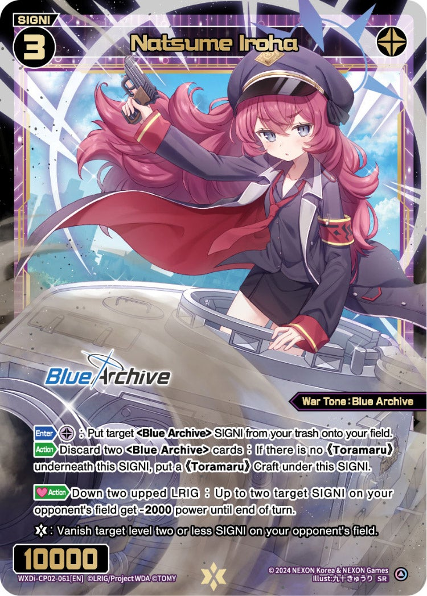

# Natsume Iroha

## Thông tin lá

| Trường | Giá trị |
| --- | --- |
| Mã in | WXDi-CP02-061[EN] |
| Set | WXDi-CP02[EN] |
| Số thứ tự | 061 |
| Loại thẻ | SIGNI |
| Vị trí | Main Deck |
| Số bản | — (set booster, không áp dụng) |
| Màu | Đen |
| Độ hiếm | SR,SRP |
| Minh họa | 九十きゅうり |
| Level | 3 |
| Limit | — |
| Power | 10000 |
| LRIG type / Class | War Tone：Blue Archive |
| Team / Master | — |
| Cost | — |
| Grow cost | — |
| Use timing | — |
| Life Burst | Có |

## Card text chính thức

[Enter] {Black}: Put target <Blue Archive> SIGNI from your trash onto your field.
[Action] Discard two <Blue Archive> cards: If there is no 《Toramaru》 underneath this SIGNI, put a 《Toramaru》 Craft under this SIGNI.

[Relationship Action] Down two upped LRIG: Up to two target SIGNI on your opponent's field get -2000 power until end of turn.

## Power text / Life Burst

Vanish target level two or less SIGNI on your opponent's field.

## Ghi chú minh họa
Artist: 九十きゅうり. Ảnh SR được tải từ Card List tiếng Anh.

## FAQ chính thức

**Q. May I put SIGNI that I paid for as {black} Ener onto the field by the [Enter] ability?**
A. Yes, you can put it. Pay {black} as a cost, then target SIGNI in your trash.

**Q. What is Craft?**
A. Craft is a substitute card that is created during the game by the effect of a card. Please refer to the glossary “Craft” for detailed rules of Craft. Please use the tokens include in the pack when you play. You can also prepare your own markers as long as they are not mixed with other cards and are not designed in a way that is inconvenient for the game.

**Q. What happens to the 《Toramaru》 that was underneath the 《Natsume Iroha》 when 《Natsume Iroha》 with 《Toramaru》 underneath it leaves the field?**
A. Cards placed underneath a SIGNI are put into their trash when that SIGNI leaves the field. 《Toramaru》 is a Craft, so instead of being put in the trash, it is removed from the game.

**Q. How can I use the [Relationship Auto] ability?**
A. The effect of cards are to “Start a relationship with the student” and if you declare student's name from Blue Archive at that time, the [Releationship Auto] abilitiy will be enabled. The relationship will never be lost.

## Ảnh biến thể

- [SRP](../images/WXDi-CP02-061P-EN.jpg)

## Nguồn
[Card List/FAQ chính thức](https://www.takaratomy.co.jp/products/en.wixoss/card/card.html?card_no=WXDi-CP02-061%5BEN%5D ) · [Ảnh thẻ](https://www.takaratomy.co.jp/products/en.wixoss/card/thumb/WXDi-CP02-061%5BEN%5D.jpg)
