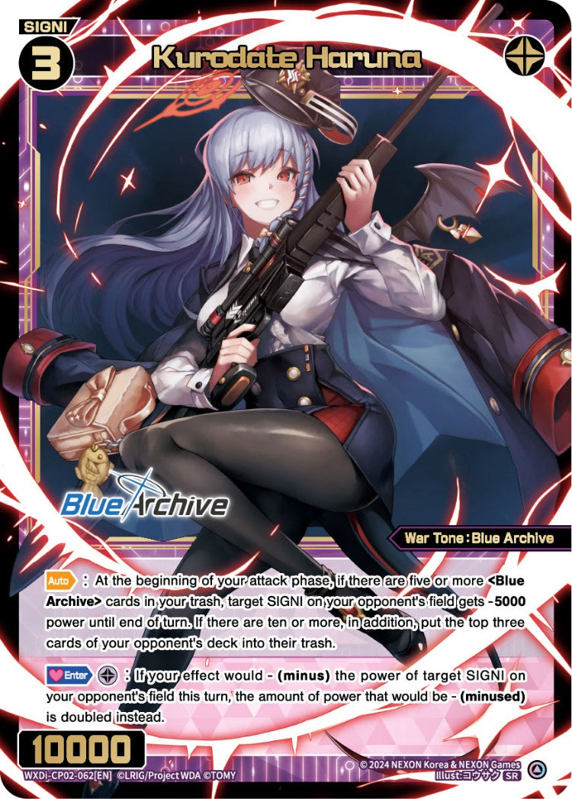

# Kurodate Haruna

## Thông tin lá

| Trường | Giá trị |
| --- | --- |
| Mã in | WXDi-CP02-062[EN] |
| Set | WXDi-CP02[EN] |
| Số thứ tự | 062 |
| Loại thẻ | SIGNI |
| Vị trí | Main Deck |
| Số bản | — (set booster, không áp dụng) |
| Màu | Đen |
| Độ hiếm | SR,SRP |
| Minh họa | コウサク |
| Level | 3 |
| Limit | — |
| Power | 10000 |
| LRIG type / Class | War Tone：Blue Archive |
| Team / Master | — |
| Cost | — |
| Grow cost | — |
| Use timing | — |
| Life Burst | Không |

## Card text chính thức

[Auto]: At the beginning of your attack phase, if there are five or more <Blue Archive> cards in your trash, target SIGNI on your opponent's field gets -5000 power until end of turn. If there are ten or more, in addition, put the top three cards of your opponent's deck into their trash.

[Relationship Enter] {Black}: If your effect would - (minus) the power of target SIGNI on your opponent's field this turn, the amount of power that would be - (minused) is doubled instead.

## Power text / Life Burst

—

## Ghi chú minh họa
Artist: コウサク. Ảnh SR được tải từ Card List tiếng Anh.

## FAQ chính thức

**Q. How can I use the [Relationship Enter] ability?**
A. The effect of cards are to “Start a relationship with the student” and if you declare student's name from Blue Archive at that time, the [Releationship Enter] abilitiy will be enabled. [Relationship Enter] ability is be trigger when enter the field after started a relationship student.

## Ảnh biến thể

- [SRP](../images/WXDi-CP02-062P-EN.jpg)

## Nguồn
[Card List/FAQ chính thức](https://www.takaratomy.co.jp/products/en.wixoss/card/card.html?card_no=WXDi-CP02-062%5BEN%5D ) · [Ảnh thẻ](https://www.takaratomy.co.jp/products/en.wixoss/card/thumb/WXDi-CP02-062%5BEN%5D.jpg)
