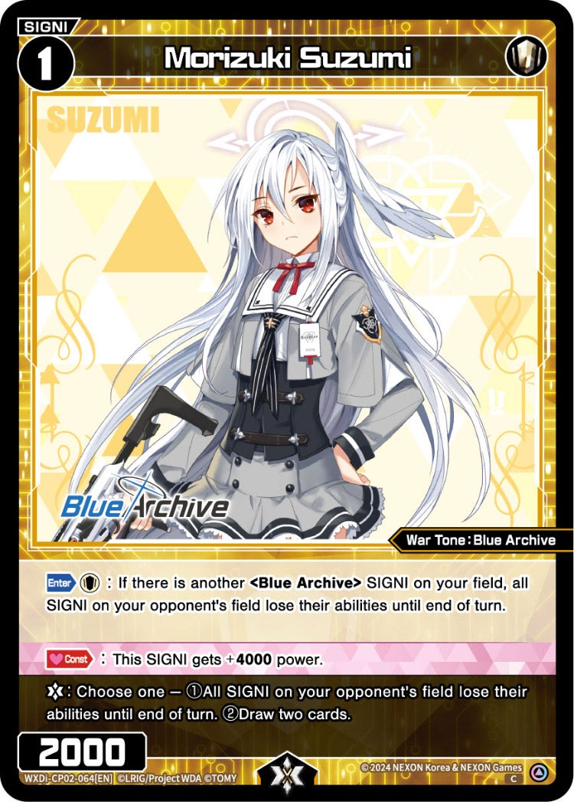

# Morizuki Suzumi

## Thông tin lá

| Trường | Giá trị |
| --- | --- |
| Mã in | WXDi-CP02-064[EN] |
| Set | WXDi-CP02[EN] |
| Số thứ tự | 064 |
| Loại thẻ | SIGNI |
| Vị trí | Main Deck |
| Số bản | — (set booster, không áp dụng) |
| Màu | Trắng |
| Độ hiếm | C,C(P) |
| Minh họa | — |
| Level | 1 |
| Limit | — |
| Power | 2000 |
| LRIG type / Class | War Tone：Blue Archive |
| Team / Master | — |
| Cost | — |
| Grow cost | — |
| Use timing | — |
| Life Burst | Có |

## Card text chính thức

[Enter] {White}: If there is another <Blue Archive> SIGNI on your field, all SIGNI on your opponent's field lose their abilities until end of turn.

[Relationship Constant]: This SIGNI gets +4000 power.

## Power text / Life Burst

Choose one — ①All SIGNI on your opponent's field lose their abilities until end of turn. ②Draw two cards.

## Ghi chú minh họa
Artist: —. Ảnh C được tải từ Card List tiếng Anh.

## FAQ chính thức

**Q. What is the state of “loses its abilities”?**
A. The information in the text field will be treated as gone. Other information such as power, level, class, name, etc., will remain unchanged. Any effects that were gained later, such as “gains ~,” will also be lost.

**Q. How can I use the [Relationship Auto] ability?**
A. The effect of cards are to “Start a relationship with the student” and if you declare student's name from Blue Archive at that time, the [Releationship Auto] abilitiy will be enabled. The relationship will never be lost.

## Ảnh biến thể

- [C(P)](../images/WXDi-CP02-064P-EN.jpg)

## Nguồn
[Card List/FAQ chính thức](https://www.takaratomy.co.jp/products/en.wixoss/card/card.html?card_no=WXDi-CP02-064%5BEN%5D ) · [Ảnh thẻ](https://www.takaratomy.co.jp/products/en.wixoss/card/thumb/WXDi-CP02-064%5BEN%5D.jpg)
