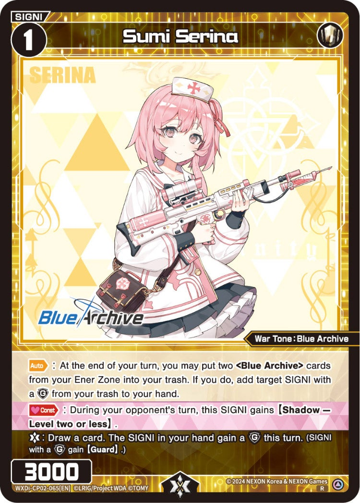

# Sumi Serina

## Thông tin lá

| Trường | Giá trị |
| --- | --- |
| Mã in | WXDi-CP02-065[EN] |
| Set | WXDi-CP02[EN] |
| Số thứ tự | 065 |
| Loại thẻ | SIGNI |
| Vị trí | Main Deck |
| Số bản | — (set booster, không áp dụng) |
| Màu | Trắng |
| Độ hiếm | R,R(P) |
| Minh họa | — |
| Level | 1 |
| Limit | — |
| Power | 3000 |
| LRIG type / Class | War Tone：Blue Archive |
| Team / Master | — |
| Cost | — |
| Grow cost | — |
| Use timing | — |
| Life Burst | Có |

## Card text chính thức

[Auto]: At the end of your turn, you may put two <Blue Archive> cards from your Ener Zone into your trash. If you do, add target SIGNI with a {Guard Icon} from your trash to your hand.

[Relationship Constant]: During your opponent's turn, this SIGNI gains 【Shadow — Level two or less】.

## Power text / Life Burst

Draw a card. The SIGNI in your hand gain a {Guard Icon} this turn. (SIGNI with a {Guard Icon} gain 【Guard】.)

## Ghi chú minh họa
Artist: —. Ảnh R được tải từ Card List tiếng Anh.

## FAQ chính thức

**Q. How can I use the [Relationship Auto] ability?**
A. The effect of cards are to “Start a relationship with the student” and if you declare student's name from Blue Archive at that time, the [Releationship Auto] abilitiy will be enabled. The relationship will never be lost.

**Q. What effect does [Shadow] have?**
A. Prevents SIGNI with [Shadow] from being chosen by your opponent's effects that target SIGNI, such as "Target SIGNI". Conversely, it does not prevent an effect such as "Vanish all SIGNI", as it does not choose target SIGNI (in which case it will be vanished). [Shadow - level two or less] is not targeted by effect of level two or less SIGNI or LRIG, and Life Burst from cards that are level two or less SIGNI.

## Ảnh biến thể

- [R(P)](../images/WXDi-CP02-065P-EN.jpg)

## Nguồn
[Card List/FAQ chính thức](https://www.takaratomy.co.jp/products/en.wixoss/card/card.html?card_no=WXDi-CP02-065%5BEN%5D ) · [Ảnh thẻ](https://www.takaratomy.co.jp/products/en.wixoss/card/thumb/WXDi-CP02-065%5BEN%5D.jpg)
