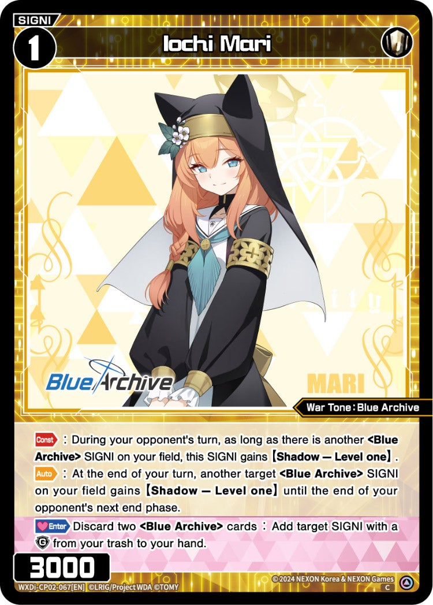

# Iochi Mari

## Thông tin lá

| Trường | Giá trị |
| --- | --- |
| Mã in | WXDi-CP02-067[EN] |
| Set | WXDi-CP02[EN] |
| Số thứ tự | 067 |
| Loại thẻ | SIGNI |
| Vị trí | Main Deck |
| Số bản | — (set booster, không áp dụng) |
| Màu | Trắng |
| Độ hiếm | C,C(P) |
| Minh họa | — |
| Level | 1 |
| Limit | — |
| Power | 3000 |
| LRIG type / Class | War Tone：Blue Archive |
| Team / Master | — |
| Cost | — |
| Grow cost | — |
| Use timing | — |
| Life Burst | Không |

## Card text chính thức

[Constant]: During your opponent's turn, as long as there is another <Blue Archive> SIGNI on your field, this SIGNI gains 【Shadow — Level one】.
[Auto]: At the end of your turn, another target <Blue Archive> SIGNI on your field gains 【Shadow — Level one】 until the end of your opponent's next end phase.

[Relationship Enter] Discard two <Blue Archive> cards: Add target SIGNI with a {Guard Icon} from your trash to your hand.

## Power text / Life Burst

—

## Ghi chú minh họa
Artist: —. Ảnh C được tải từ Card List tiếng Anh.

## FAQ chính thức

**Q. What effect does [Shadow] have?**
A. Prevents SIGNI with [Shadow] from being chosen by your opponent's effects that target SIGNI, such as "Target SIGNI". Conversely, it does not prevent an effect such as "Vanish all SIGNI", as it does not choose target SIGNI (in which case it will be vanished). [Shadow - level two or less] is not targeted by effect of level two or less SIGNI or LRIG, and Life Burst from cards that are level two or less SIGNI.

**Q. How can I use the [Relationship Enter] ability?**
A. The effect of cards are to “Start a relationship with the student” and if you declare student's name from Blue Archive at that time, the [Releationship Enter] abilitiy will be enabled. [Relationship Enter] ability is be trigger when enter the field after started a relationship student.

## Ảnh biến thể

- [C(P)](../images/WXDi-CP02-067P-EN.jpg)

## Nguồn
[Card List/FAQ chính thức](https://www.takaratomy.co.jp/products/en.wixoss/card/card.html?card_no=WXDi-CP02-067%5BEN%5D ) · [Ảnh thẻ](https://www.takaratomy.co.jp/products/en.wixoss/card/thumb/WXDi-CP02-067%5BEN%5D.jpg)
