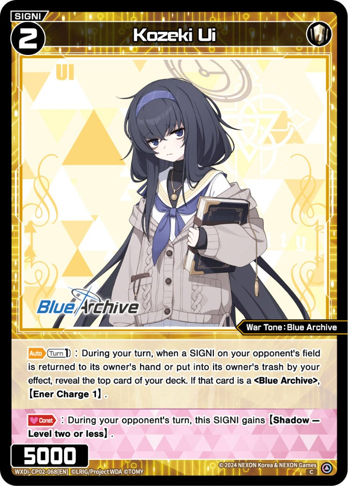

# Kozeki Ui

## Thông tin lá

| Trường | Giá trị |
| --- | --- |
| Mã in | WXDi-CP02-068[EN] |
| Set | WXDi-CP02[EN] |
| Số thứ tự | 068 |
| Loại thẻ | SIGNI |
| Vị trí | Main Deck |
| Số bản | — (set booster, không áp dụng) |
| Màu | Trắng |
| Độ hiếm | C,C(P) |
| Minh họa | — |
| Level | 2 |
| Limit | — |
| Power | 5000 |
| LRIG type / Class | War Tone：Blue Archive |
| Team / Master | — |
| Cost | — |
| Grow cost | — |
| Use timing | — |
| Life Burst | Không |

## Card text chính thức

[Auto] {1/Turn}: During your turn, when a SIGNI on your opponent's field is returned to its owner's hand or put into its owner's trash by your effect, reveal the top card of your deck. If that card is <Blue Archive>, 【Ener Charge 1】.

[Relationship Constant]: During your opponent's turn, this SIGNI gains 【Shadow — Level two or less】.

## Power text / Life Burst

—

## Ghi chú minh họa
Artist: —. Ảnh C được tải từ Card List tiếng Anh.

## FAQ chính thức

**Q. When I discarded my opponent's card in their hand by my effect, it is a SIGNI. Does this [Auto] ability trigger?**
A. No, it does not trigger. This [Auto] ability triggers when a SIGNI that on your opponent's field as a SIGNI is returned to their hand or put into their owner's trash.

**Q. As [Auto] ability of 《Shizuyama Mashiro》, my SIGNI to gainned “[Constant]: If a SIGNI on your opponent's field is vanished through battle with this SIGNI, it is put into the trash instead of the Ener Zone”. If that SIGNI vanishes my opponent's SIGNI in a battle and my opponent's SIGNI is put into its owner's trash, does the [Auto] ability of 《Kozeki Ui》 trigger?**
A. No, it does not trigger. The ability gainned by 《Shizuyama Mashiro》 only replaces the place where the card is placed when it is vanished by the battle, and the card itself is moved by the battle. Since your effect does not directly move the card, the [Auto] ability of 《Kozeki Ui》 does not trigger.

**Q. What effect does [Shadow] have?**
A. Prevents SIGNI with [Shadow] from being chosen by your opponent's effects that target SIGNI, such as "Target SIGNI". Conversely, it does not prevent an effect such as "Vanish all SIGNI", as it does not choose target SIGNI (in which case it will be vanished). [Shadow - level two or less] is not targeted by effect of level two or less SIGNI or LRIG, and Life Burst from cards that are level two or less SIGNI.

**Q. How can I use the [Relationship Auto] ability?**
A. The effect of cards are to “Start a relationship with the student” and if you declare student's name from Blue Archive at that time, the [Releationship Auto] abilitiy will be enabled. The relationship will never be lost.

## Ảnh biến thể

- [C(P)](../images/WXDi-CP02-068P-EN.jpg)

## Nguồn
[Card List/FAQ chính thức](https://www.takaratomy.co.jp/products/en.wixoss/card/card.html?card_no=WXDi-CP02-068%5BEN%5D ) · [Ảnh thẻ](https://www.takaratomy.co.jp/products/en.wixoss/card/thumb/WXDi-CP02-068%5BEN%5D.jpg)
