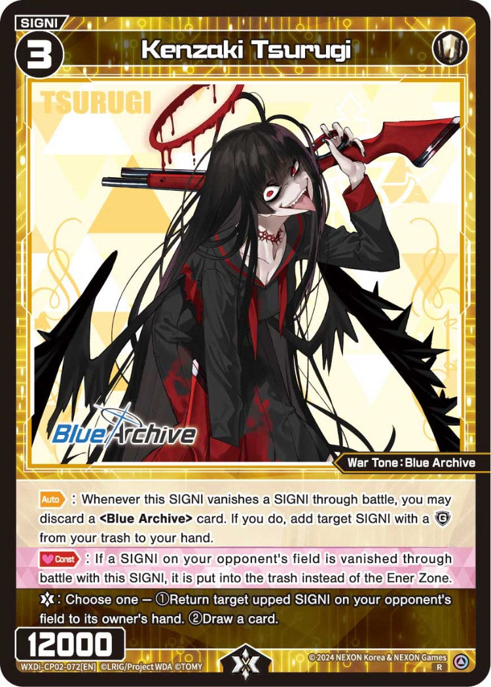

# Kenzaki Tsurugi

## Thông tin lá

| Trường | Giá trị |
| --- | --- |
| Mã in | WXDi-CP02-072[EN] |
| Set | WXDi-CP02[EN] |
| Số thứ tự | 072 |
| Loại thẻ | SIGNI |
| Vị trí | Main Deck |
| Số bản | — (set booster, không áp dụng) |
| Màu | Trắng |
| Độ hiếm | R,R(P) |
| Minh họa | — |
| Level | 3 |
| Limit | — |
| Power | 12000 |
| LRIG type / Class | War Tone：Blue Archive |
| Team / Master | — |
| Cost | — |
| Grow cost | — |
| Use timing | — |
| Life Burst | Có |

## Card text chính thức

[Auto]: Whenever this SIGNI vanishes a SIGNI through battle, you may discard a <Blue Archive> card. If you do, add target SIGNI with a {Guard Icon} from your trash to your hand.

[Relationship Constant]: If a SIGNI on your opponent's field is vanished through battle with this SIGNI, it is put into the trash instead of the Ener Zone.

## Power text / Life Burst

Choose one — ①Return target upped SIGNI on your opponent's field to its owner's hand. ②Draw a card.

## Ghi chú minh họa
Artist: —. Ảnh R được tải từ Card List tiếng Anh.

## FAQ chính thức

**Q. When the [Relationship Const] ability is enabled. if This SIGNI battle with my opponent's SIGNI and it is put into the trash, does this SIGNI's [Auto] ability still trigger?**
A. Yes, it does trigger. This [Relationship Const] ability only replace the place where it is placed when it is vanished, and in this case it is also vanished in battle, so the [Auto] ability is triggered.

**Q. How can I use the [Relationship Auto] ability?**
A. The effect of cards are to “Start a relationship with the student” and if you declare student's name from Blue Archive at that time, the [Releationship Auto] abilitiy will be enabled. The relationship will never be lost.

## Ảnh biến thể

- [R(P)](../images/WXDi-CP02-072P-EN.jpg)

## Nguồn
[Card List/FAQ chính thức](https://www.takaratomy.co.jp/products/en.wixoss/card/card.html?card_no=WXDi-CP02-072%5BEN%5D ) · [Ảnh thẻ](https://www.takaratomy.co.jp/products/en.wixoss/card/thumb/WXDi-CP02-072%5BEN%5D.jpg)
