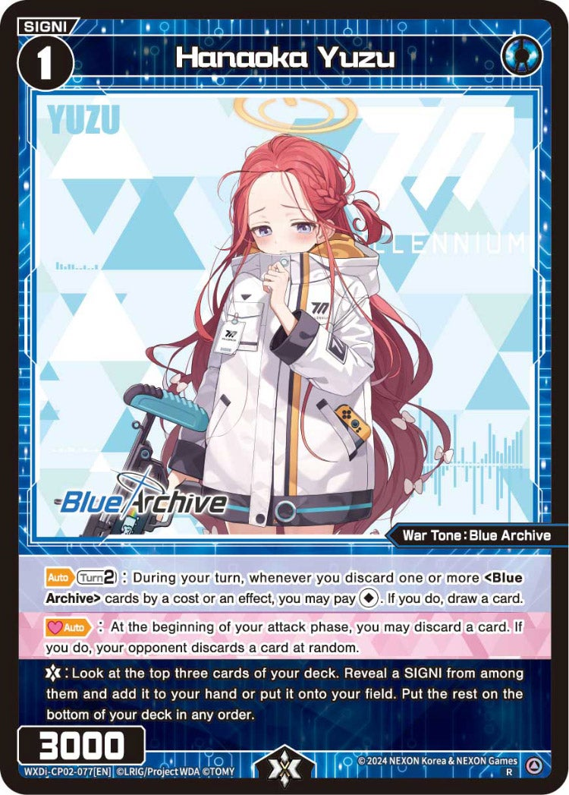

# Hanaoka Yuzu

## Thông tin lá

| Trường | Giá trị |
| --- | --- |
| Mã in | WXDi-CP02-077[EN] |
| Set | WXDi-CP02[EN] |
| Số thứ tự | 077 |
| Loại thẻ | SIGNI |
| Vị trí | Main Deck |
| Số bản | — (set booster, không áp dụng) |
| Màu | Xanh dương |
| Độ hiếm | R,R(P) |
| Minh họa | — |
| Level | 1 |
| Limit | — |
| Power | 3000 |
| LRIG type / Class | War Tone：Blue Archive |
| Team / Master | — |
| Cost | — |
| Grow cost | — |
| Use timing | — |
| Life Burst | Có |

## Card text chính thức

[Auto] {2/Turn}: During your turn, whenever you discard one or more <Blue Archive> cards by a cost or an effect, you may pay {Colorless}. If you do, draw a card.

[Relationship Auto]: At the beginning of your attack phase, you may discard a card. If you do, your opponent discards a card at random.

## Power text / Life Burst

Look at the top three cards of your deck. Reveal a SIGNI from among them and add it to your hand or put it onto your field. Put the rest on the bottom of your deck in any order.

## Ghi chú minh họa
Artist: —. Ảnh R được tải từ Card List tiếng Anh.

## FAQ chính thức

**Q. If I pay the cost of “discard two cards,” how many times does the [Auto] ability trigger?**
A. In that case, discarding those two cards is a single process, and this [Auto] ability will trigger only once because the condition is “whenever one or more <Blue Archive> cards”. If the two cards are discarded in two separate processes, this [Auto] ability will trigger twice, but if multiple cards are discarded in one process, it will only trigger once.

**Q. How can I use the [Relationship Auto] ability?**
A. The effect of cards are to “Start a relationship with the student” and if you declare student's name from Blue Archive at that time, the [Releationship Auto] abilitiy will be enabled. The relationship will never be lost.

## Ảnh biến thể

- [R(P)](../images/WXDi-CP02-077P-EN.jpg)

## Nguồn
[Card List/FAQ chính thức](https://www.takaratomy.co.jp/products/en.wixoss/card/card.html?card_no=WXDi-CP02-077%5BEN%5D ) · [Ảnh thẻ](https://www.takaratomy.co.jp/products/en.wixoss/card/thumb/WXDi-CP02-077%5BEN%5D.jpg)
