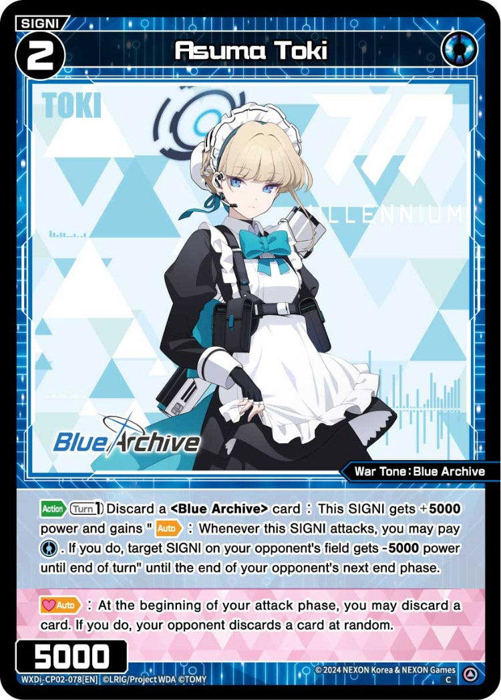

# Asuma Toki

## Thông tin lá

| Trường | Giá trị |
| --- | --- |
| Mã in | WXDi-CP02-078[EN] |
| Set | WXDi-CP02[EN] |
| Số thứ tự | 078 |
| Loại thẻ | SIGNI |
| Vị trí | Main Deck |
| Số bản | — (set booster, không áp dụng) |
| Màu | Xanh dương |
| Độ hiếm | C,C(P) |
| Minh họa | — |
| Level | 2 |
| Limit | — |
| Power | 5000 |
| LRIG type / Class | War Tone：Blue Archive |
| Team / Master | — |
| Cost | — |
| Grow cost | — |
| Use timing | — |
| Life Burst | Không |

## Card text chính thức

[Action] {1/Turn} Discard a <Blue Archive> card: This SIGNI gets +5000 power and gains "[Auto]: Whenever this SIGNI attacks, you may pay {Blue}. If you do, target SIGNI on your opponent's field gets -5000 power until end of turn" until the end of your opponent's next end phase.

[Relationship Auto]: At the beginning of your attack phase, you may discard a card. If you do, your opponent discards a card at random.

## Power text / Life Burst

—

## Ghi chú minh họa
Artist: —. Ảnh C được tải từ Card List tiếng Anh.

## FAQ chính thức

**Q. This SIGNI attacked and I used the [Auto] ability to vanish the SIGNI in front of it. Does this attack deal damage to my opponent?**
A. Yes, it does. As you attack, you must first resolve all the [Auto] abilities when you attack, etc. before the attack itself is processed, so if there are no more SIGNI in front of your SIGNI at that time, you will deal damage to your opponent.

**Q. How can I use the [Relationship Auto] ability?**
A. The effect of cards are to “Start a relationship with the student” and if you declare student's name from Blue Archive at that time, the [Releationship Auto] abilitiy will be enabled. The relationship will never be lost.

## Ảnh biến thể

- [C(P)](../images/WXDi-CP02-078P-EN.jpg)

## Nguồn
[Card List/FAQ chính thức](https://www.takaratomy.co.jp/products/en.wixoss/card/card.html?card_no=WXDi-CP02-078%5BEN%5D ) · [Ảnh thẻ](https://www.takaratomy.co.jp/products/en.wixoss/card/thumb/WXDi-CP02-078%5BEN%5D.jpg)
