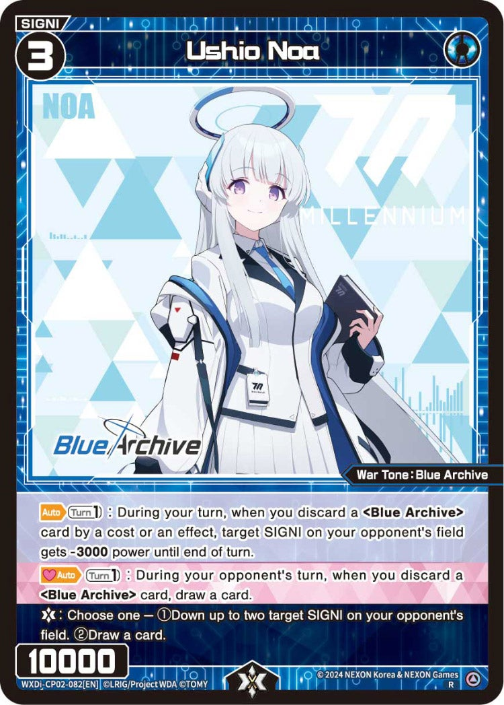

# Ushio Noa

## Thông tin lá

| Trường | Giá trị |
| --- | --- |
| Mã in | WXDi-CP02-082[EN] |
| Set | WXDi-CP02[EN] |
| Số thứ tự | 082 |
| Loại thẻ | SIGNI |
| Vị trí | Main Deck |
| Số bản | — (set booster, không áp dụng) |
| Màu | Xanh dương |
| Độ hiếm | R,R(P) |
| Minh họa | — |
| Level | 3 |
| Limit | — |
| Power | 10000 |
| LRIG type / Class | War Tone：Blue Archive |
| Team / Master | — |
| Cost | — |
| Grow cost | — |
| Use timing | — |
| Life Burst | Có |

## Card text chính thức

[Auto] {1/Turn}: During your turn, when you discard a <Blue Archive> card by a cost or an effect, target SIGNI on your opponent's field gets -3000 power until end of turn.

[Relationship Auto] {1/Turn}: During your opponent's turn, when you discard a <Blue Archive> card, draw a card.

## Power text / Life Burst

Choose one — ①Down up to two target SIGNI on your opponent's field. ②Draw a card.

## Ghi chú minh họa
Artist: —. Ảnh R được tải từ Card List tiếng Anh.

## FAQ chính thức

**Q. If I discard two <Blue Archive> cards at the cost of “discard two cards”, does this [Auto] ability trigger?**
A. Yes, it is triggered. It is an ability with a once per turn limit, so it is only triggered once.

**Q. How can I use the [Relationship Auto] ability?**
A. The effect of cards are to “Start a relationship with the student” and if you declare student's name from Blue Archive at that time, the [Releationship Auto] abilitiy will be enabled. The relationship will never be lost.

## Ảnh biến thể

- [R(P)](../images/WXDi-CP02-082P-EN.jpg)

## Nguồn
[Card List/FAQ chính thức](https://www.takaratomy.co.jp/products/en.wixoss/card/card.html?card_no=WXDi-CP02-082%5BEN%5D ) · [Ảnh thẻ](https://www.takaratomy.co.jp/products/en.wixoss/card/thumb/WXDi-CP02-082%5BEN%5D.jpg)
