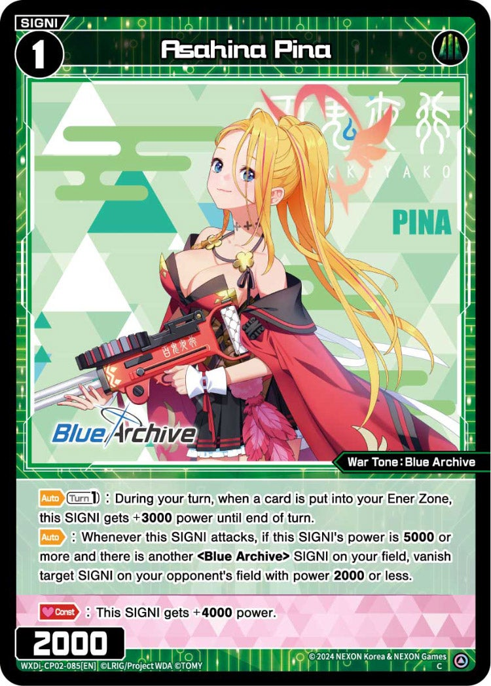

# Asahina Pina

## Thông tin lá

| Trường | Giá trị |
| --- | --- |
| Mã in | WXDi-CP02-085[EN] |
| Set | WXDi-CP02[EN] |
| Số thứ tự | 085 |
| Loại thẻ | SIGNI |
| Vị trí | Main Deck |
| Số bản | — (set booster, không áp dụng) |
| Màu | Xanh lá |
| Độ hiếm | C,C(P) |
| Minh họa | — |
| Level | 1 |
| Limit | — |
| Power | 2000 |
| LRIG type / Class | War Tone：Blue Archive |
| Team / Master | — |
| Cost | — |
| Grow cost | — |
| Use timing | — |
| Life Burst | Không |

## Card text chính thức

[Auto] {1/Turn}: During your turn, when a card is put into your Ener Zone, this SIGNI gets +3000 power until end of turn.
[Auto]: Whenever this SIGNI attacks, if this SIGNI's power is 5000 or more and there is another <Blue Archive> SIGNI on your field, vanish target SIGNI on your opponent's field with power 2000 or less.

[Relationship Constant]: This SIGNI gets +4000 power.

## Power text / Life Burst

—

## Ghi chú minh họa
Artist: —. Ảnh C được tải từ Card List tiếng Anh.

## FAQ chính thức

**Q. This SIGNI attacked and I used the second [Auto] ability to vanish the SIGNI in front of it. Does this attack deal damage to my opponent?**
A. Yes, it does. When your SIGNI attack, you must first resolve all the [Auto] abilities when your SIGNI attack, etc. before the attack itself is processed, so if there are no more SIGNI in front of your SIGNI at that time, your SIGNI will deal damage to your opponent.

**Q. How can I use the [Relationship Auto] ability?**
A. The effect of cards are to “Start a relationship with the student” and if you declare student's name from Blue Archive at that time, the [Releationship Auto] abilitiy will be enabled. The relationship will never be lost.

## Ảnh biến thể

- [C(P)](../images/WXDi-CP02-085P-EN.jpg)

## Nguồn
[Card List/FAQ chính thức](https://www.takaratomy.co.jp/products/en.wixoss/card/card.html?card_no=WXDi-CP02-085%5BEN%5D ) · [Ảnh thẻ](https://www.takaratomy.co.jp/products/en.wixoss/card/thumb/WXDi-CP02-085%5BEN%5D.jpg)
