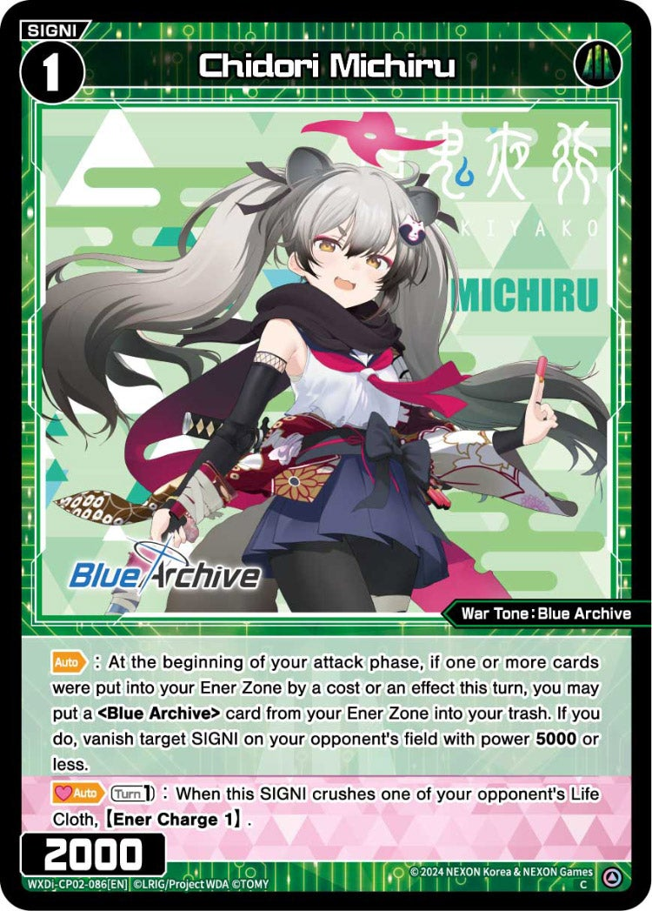

# Chidori Michiru

## Thông tin lá

| Trường | Giá trị |
| --- | --- |
| Mã in | WXDi-CP02-086[EN] |
| Set | WXDi-CP02[EN] |
| Số thứ tự | 086 |
| Loại thẻ | SIGNI |
| Vị trí | Main Deck |
| Số bản | — (set booster, không áp dụng) |
| Màu | Xanh lá |
| Độ hiếm | C,C(P) |
| Minh họa | — |
| Level | 1 |
| Limit | — |
| Power | 2000 |
| LRIG type / Class | War Tone：Blue Archive |
| Team / Master | — |
| Cost | — |
| Grow cost | — |
| Use timing | — |
| Life Burst | Không |

## Card text chính thức

[Auto]: At the beginning of your attack phase, if one or more cards were put into your Ener Zone by a cost or an effect this turn, you may put a <Blue Archive> card from your Ener Zone into your trash. If you do, vanish target SIGNI on your opponent's field with power 5000 or less.

[Relationship Auto] {1/Turn}: When this SIGNI crushes one of your opponent's Life Cloth, 【Ener Charge 1】.

## Power text / Life Burst

—

## Ghi chú minh họa
Artist: —. Ảnh C được tải từ Card List tiếng Anh.

## FAQ chính thức

**Q. If my SIGNI was vanished by my opponent's effect this turn, does the [Auto] ability trigger?**
A. Yes, the condition is met because the card is put into your Ener Zone from the field due to the effect of the vanish.

**Q. How can I use the [Relationship Auto] ability?**
A. The effect of cards are to “Start a relationship with the student” and if you declare student's name from Blue Archive at that time, the [Releationship Auto] abilitiy will be enabled. The relationship will never be lost.

## Ảnh biến thể

- [C(P)](../images/WXDi-CP02-086P-EN.jpg)

## Nguồn
[Card List/FAQ chính thức](https://www.takaratomy.co.jp/products/en.wixoss/card/card.html?card_no=WXDi-CP02-086%5BEN%5D ) · [Ảnh thẻ](https://www.takaratomy.co.jp/products/en.wixoss/card/thumb/WXDi-CP02-086%5BEN%5D.jpg)
