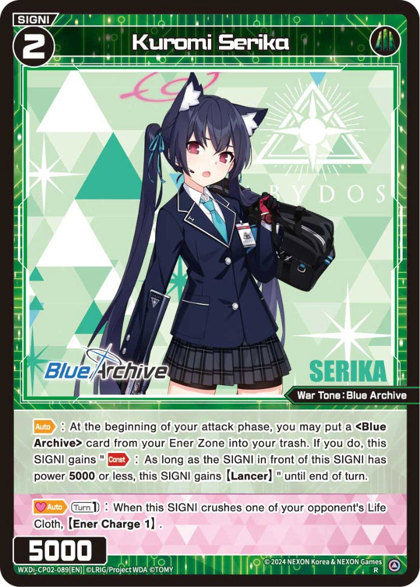

# Kuromi Serika

## Thông tin lá

| Trường | Giá trị |
| --- | --- |
| Mã in | WXDi-CP02-089[EN] |
| Set | WXDi-CP02[EN] |
| Số thứ tự | 089 |
| Loại thẻ | SIGNI |
| Vị trí | Main Deck |
| Số bản | — (set booster, không áp dụng) |
| Màu | Xanh lá |
| Độ hiếm | R,R(P) |
| Minh họa | — |
| Level | 2 |
| Limit | — |
| Power | 5000 |
| LRIG type / Class | War Tone：Blue Archive |
| Team / Master | — |
| Cost | — |
| Grow cost | — |
| Use timing | — |
| Life Burst | Không |

## Card text chính thức

[Auto]: At the beginning of your attack phase, you may put a <Blue Archive> card from your Ener Zone into your trash. If you do, this SIGNI gains "[Constant]: As long as the SIGNI in front of this SIGNI has power 5000 or less, this SIGNI gains 【Lancer】" until end of turn.

[Relationship Auto] {1/Turn}: When this SIGNI crushes one of your opponent's Life Cloth, 【Ener Charge 1】.

## Power text / Life Burst

—

## Ghi chú minh họa
Artist: —. Ảnh R được tải từ Card List tiếng Anh.

## FAQ chính thức

**Q. If this SIGNI's [Lancer] triggers and crushes my opponent's Life Cloth, does it still trigger the [Relationship Auto] ability?**
A. Yes, it is triggered.

**Q. How can I use the [Relationship Auto] ability?**
A. The effect of cards are to “Start a relationship with the student” and if you declare student's name from Blue Archive at that time, the [Releationship Auto] abilitiy will be enabled. The relationship will never be lost.

## Ảnh biến thể

- [R(P)](../images/WXDi-CP02-089P-EN.jpg)

## Nguồn
[Card List/FAQ chính thức](https://www.takaratomy.co.jp/products/en.wixoss/card/card.html?card_no=WXDi-CP02-089%5BEN%5D ) · [Ảnh thẻ](https://www.takaratomy.co.jp/products/en.wixoss/card/thumb/WXDi-CP02-089%5BEN%5D.jpg)
