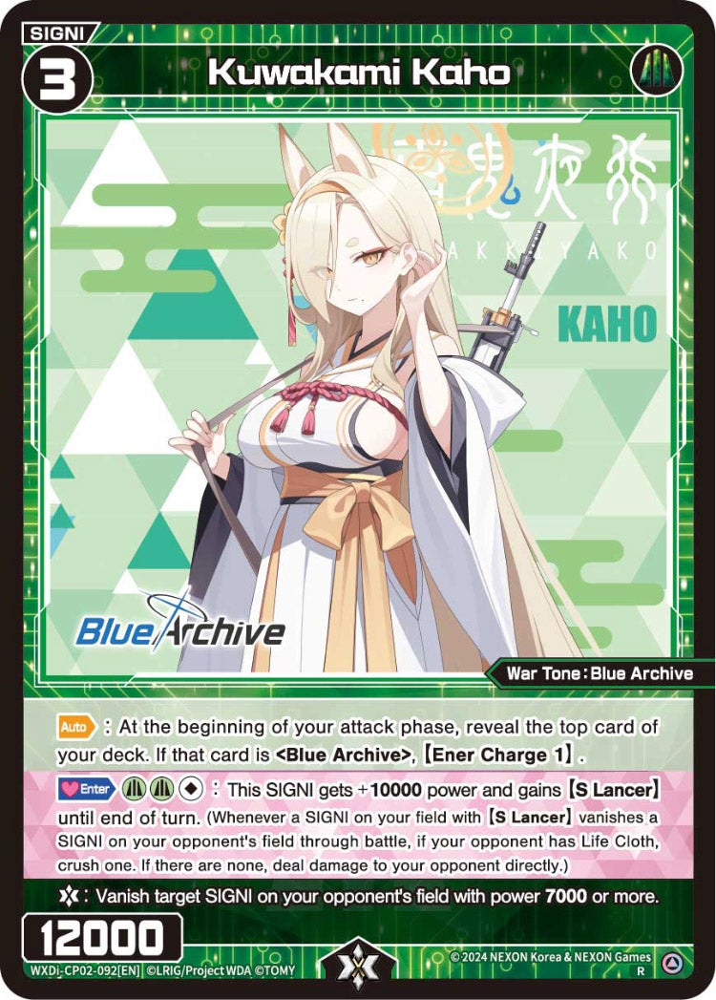

# Kuwakami Kaho

## Thông tin lá

| Trường | Giá trị |
| --- | --- |
| Mã in | WXDi-CP02-092[EN] |
| Set | WXDi-CP02[EN] |
| Số thứ tự | 092 |
| Loại thẻ | SIGNI |
| Vị trí | Main Deck |
| Số bản | — (set booster, không áp dụng) |
| Màu | Xanh lá |
| Độ hiếm | R,R(P) |
| Minh họa | — |
| Level | 3 |
| Limit | — |
| Power | 12000 |
| LRIG type / Class | War Tone：Blue Archive |
| Team / Master | — |
| Cost | — |
| Grow cost | — |
| Use timing | — |
| Life Burst | Có |

## Card text chính thức

[Auto]: At the beginning of your attack phase, reveal the top card of your deck. If that card is <Blue Archive>, 【Ener Charge 1】.

[Relationship Enter] {Green} {Green} {Colorless}: This SIGNI gets +10000 power and gains 【S Lancer】 until end of turn. (Whenever a SIGNI on your field with 【S Lancer】 vanishes a SIGNI on your opponent's field through battle, if your opponent has Life Cloth, crush one. If there are none, deal damage to your opponent directly.)

## Power text / Life Burst

Vanish target SIGNI on your opponent's field with power 7000 or more.

## Ghi chú minh họa
Artist: —. Ảnh R được tải từ Card List tiếng Anh.

## FAQ chính thức

**Q. How can I use the [Relationship Enter] ability?**
A. The effect of cards are to “Start a relationship with the student” and if you declare student's name from Blue Archive at that time, the [Releationship Enter] abilitiy will be enabled. [Relationship Enter] ability is be trigger when enter the field after started a relationship student.

**Q. What kind of ability does [S Lancer] have?**
A. When a SIGNI with [S Lancer] vanishes an opponent's SIGNI by battle, it crushes an opponent's Life Cloth, and if the opponent has no Life Cloth, it deals damage to the opponent. Even if a SIGNI has more than one [Lancer] or [S Lancer], it can only be triggered once in one battle.

## Ảnh biến thể

- [R(P)](../images/WXDi-CP02-092P-EN.jpg)

## Nguồn
[Card List/FAQ chính thức](https://www.takaratomy.co.jp/products/en.wixoss/card/card.html?card_no=WXDi-CP02-092%5BEN%5D ) · [Ảnh thẻ](https://www.takaratomy.co.jp/products/en.wixoss/card/thumb/WXDi-CP02-092%5BEN%5D.jpg)
