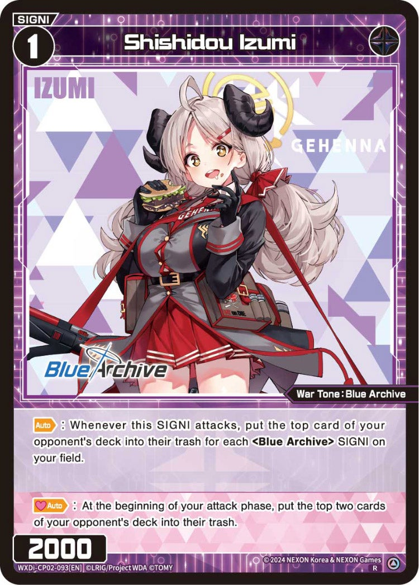

# Shishidou Izumi

## Thông tin lá

| Trường | Giá trị |
| --- | --- |
| Mã in | WXDi-CP02-093[EN] |
| Set | WXDi-CP02[EN] |
| Số thứ tự | 093 |
| Loại thẻ | SIGNI |
| Vị trí | Main Deck |
| Số bản | — (set booster, không áp dụng) |
| Màu | Đen |
| Độ hiếm | R,R(P) |
| Minh họa | — |
| Level | 1 |
| Limit | — |
| Power | 2000 |
| LRIG type / Class | War Tone：Blue Archive |
| Team / Master | — |
| Cost | — |
| Grow cost | — |
| Use timing | — |
| Life Burst | Không |

## Card text chính thức

[Auto]: Whenever this SIGNI attacks, put the top card of your opponent's deck into their trash for each <Blue Archive> SIGNI on your field.

[Relationship Auto]: At the beginning of your attack phase, put the top two cards of your opponent's deck into their trash.

## Power text / Life Burst

—

## Ghi chú minh họa
Artist: —. Ảnh R được tải từ Card List tiếng Anh.

## FAQ chính thức

**Q. This SIGNI attacks, and I have three <Blue Archive> SIGNI on my field, including 《Shishidou Izumi》, so I put the top three cards of my opponent's deck into their owner's trash. What happens if my opponent's deck become to zero cards?**
A. In that case, refresh first, and then process this SIGNI's attack.

**Q. How can I use the [Relationship Auto] ability?**
A. The effect of cards are to “Start a relationship with the student” and if you declare student's name from Blue Archive at that time, the [Releationship Auto] abilitiy will be enabled. The relationship will never be lost.

## Ảnh biến thể

- [R(P)](../images/WXDi-CP02-093P-EN.jpg)

## Nguồn
[Card List/FAQ chính thức](https://www.takaratomy.co.jp/products/en.wixoss/card/card.html?card_no=WXDi-CP02-093%5BEN%5D ) · [Ảnh thẻ](https://www.takaratomy.co.jp/products/en.wixoss/card/thumb/WXDi-CP02-093%5BEN%5D.jpg)
