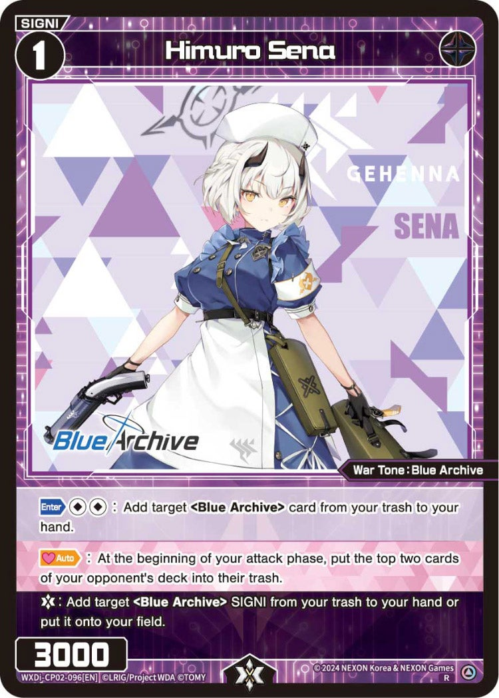

# Himuro Sena

## Thông tin lá

| Trường | Giá trị |
| --- | --- |
| Mã in | WXDi-CP02-096[EN] |
| Set | WXDi-CP02[EN] |
| Số thứ tự | 096 |
| Loại thẻ | SIGNI |
| Vị trí | Main Deck |
| Số bản | — (set booster, không áp dụng) |
| Màu | Đen |
| Độ hiếm | R,R(P) |
| Minh họa | — |
| Level | 1 |
| Limit | — |
| Power | 3000 |
| LRIG type / Class | War Tone：Blue Archive |
| Team / Master | — |
| Cost | — |
| Grow cost | — |
| Use timing | — |
| Life Burst | Có |

## Card text chính thức

[Enter] {Colorless} {Colorless}: Add target <Blue Archive> card from your trash to your hand.

[Relationship Auto]: At the beginning of your attack phase, put the top two cards of your opponent's deck into their trash.

## Power text / Life Burst

Add target <Blue Archive> SIGNI from your trash to your hand or put it onto your field.

## Ghi chú minh họa
Artist: —. Ảnh R được tải từ Card List tiếng Anh.

## FAQ chính thức

**Q. May I add SIGNI that I paid for as {colorless} Ener to my hand by the [Enter] ability?**
A. Yes, you can put it. Pay {colorless} {colorless} as a cost, then target SIGNI in your trash.

**Q. How can I use the [Relationship Auto] ability?**
A. The effect of cards are to “Start a relationship with the student” and if you declare student's name from Blue Archive at that time, the [Releationship Auto] abilitiy will be enabled. The relationship will never be lost.

## Ảnh biến thể

- [R(P)](../images/WXDi-CP02-096P-EN.jpg)

## Nguồn
[Card List/FAQ chính thức](https://www.takaratomy.co.jp/products/en.wixoss/card/card.html?card_no=WXDi-CP02-096%5BEN%5D ) · [Ảnh thẻ](https://www.takaratomy.co.jp/products/en.wixoss/card/thumb/WXDi-CP02-096%5BEN%5D.jpg)
