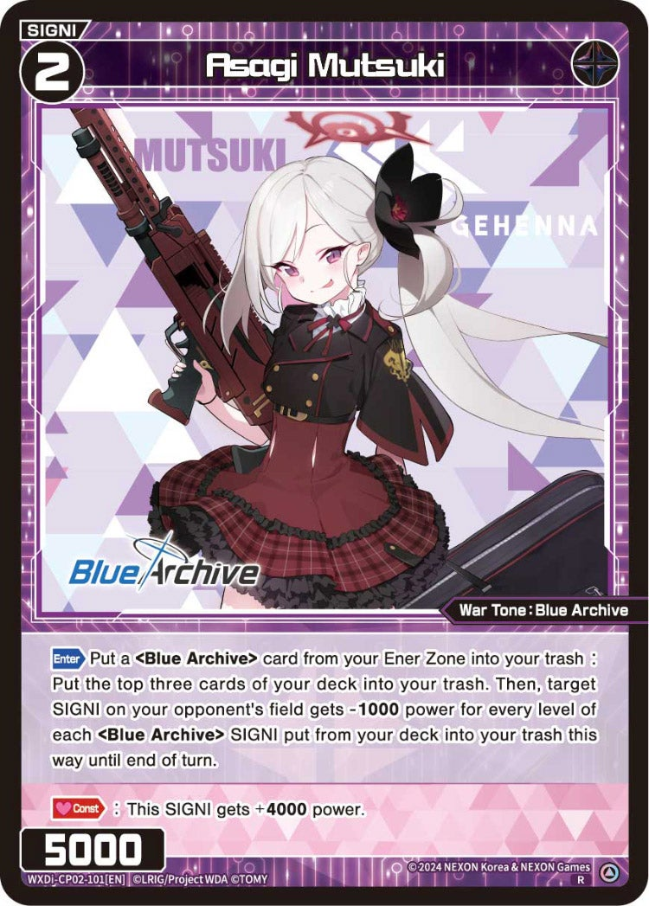

# Asagi Mutsuki

## Thông tin lá

| Trường | Giá trị |
| --- | --- |
| Mã in | WXDi-CP02-101[EN] |
| Set | WXDi-CP02[EN] |
| Số thứ tự | 101 |
| Loại thẻ | SIGNI |
| Vị trí | Main Deck |
| Số bản | — (set booster, không áp dụng) |
| Màu | Đen |
| Độ hiếm | R,R(P) |
| Minh họa | — |
| Level | 2 |
| Limit | — |
| Power | 5000 |
| LRIG type / Class | War Tone：Blue Archive |
| Team / Master | — |
| Cost | — |
| Grow cost | — |
| Use timing | — |
| Life Burst | Không |

## Card text chính thức

[Enter] Put a <Blue Archive> card from your Ener Zone into your trash: Put the top three cards of your deck into your trash. Then, target SIGNI on your opponent's field gets -1000 power for every level of each <Blue Archive> SIGNI put from your deck into your trash this way until end of turn.

[Relationship Constant]: This SIGNI gets +4000 power.

## Power text / Life Burst

—

## Ghi chú minh họa
Artist: —. Ảnh R được tải từ Card List tiếng Anh.

## FAQ chính thức

**Q. My deck became zero cards when I put the top three cards of my deck into their owner's trash by the [Enter] ability. What happens now?**
A. If the deck is reduced to zero cards, refresh is performed by the Rule-based Action processing, but the Rule-based Action processing is not performed during the processing of the effect, so this [Enter] ability is first fully processed and completed. Refresh is then performed after the processing of the [Enter] ability.

**Q. How can I use the [Relationship Auto] ability?**
A. The effect of cards are to “Start a relationship with the student” and if you declare student's name from Blue Archive at that time, the [Releationship Auto] abilitiy will be enabled. The relationship will never be lost.

## Ảnh biến thể

- [R(P)](../images/WXDi-CP02-101P-EN.jpg)

## Nguồn
[Card List/FAQ chính thức](https://www.takaratomy.co.jp/products/en.wixoss/card/card.html?card_no=WXDi-CP02-101%5BEN%5D ) · [Ảnh thẻ](https://www.takaratomy.co.jp/products/en.wixoss/card/thumb/WXDi-CP02-101%5BEN%5D.jpg)
