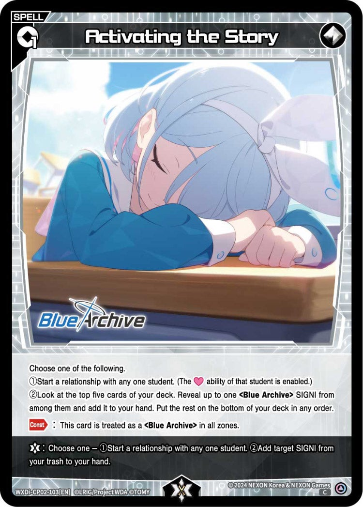

# Activating the Story

## Thông tin lá

| Trường | Giá trị |
| --- | --- |
| Mã in | WXDi-CP02-103[EN] |
| Set | WXDi-CP02[EN] |
| Số thứ tự | 103 |
| Loại thẻ | SPELL |
| Vị trí | Main Deck |
| Số bản | — (set booster, không áp dụng) |
| Màu | Không màu |
| Độ hiếm | C,C(P) |
| Minh họa | — |
| Level | — |
| Limit | — |
| Power | 0 |
| LRIG type / Class | — |
| Team / Master | — |
| Cost | 《C》×１ |
| Grow cost | — |
| Use timing | — |
| Life Burst | Có |

## Card text chính thức

Choose one of the following.
①Start a relationship with any one student. (The [Relationship] ability of that student is enabled.)
②Look at the top five cards of your deck. Reveal up to one <Blue Archive> SIGNI from among them and add it to your hand. Put the rest on the bottom of your deck in any order.

[Constant]: This card is treated as a <Blue Archive> in all zones.

## Power text / Life Burst

Choose one — ①Start a relationship with any one student. ②Add target SIGNI from your trash to your hand.

## Ghi chú minh họa
Artist: —. Ảnh C được tải từ Card List tiếng Anh.

## FAQ chính thức

**Q. What exactly is the [Const] ability?**
A. This card can be treated as <Blue Archive> when referring to the card's class. For example, it can pay the cost of “put a <Blue Archive> card from your hand into your trash” and can be added to your hand by the effect of “add a <Blue Archive> card from your trash to your hand.".
However, since it is a Spell, not a SIGNI, it cannot be referenced by effects or abilities that reference <Blue Archive> SIGNI.

**Q. What does it mean to “start a relationship with any one student”?**
A. Declare the name of a student from Blue Archive DIVA and start a relationship with that student. Cards of students who have started a relationship will enable the [Relationship] ability. Please note that you are declaring the student's name, not the card name. If you have more than one ability to start a relationship, you will start a relationship with another student for that amount of time, and it will not be lost.
For example, if you declare “Ajitani Hifumi,” you will get 《Ajitani Hifumi [Help Me, Peroro!]》 and 《Ajitani Hifumi (Swimsuit)》 will both be enabled.
Please use the tokens include in the packs or the [Relationship] chips distributed at official events as a marker of who you started a relationship for. You can also prepare your own markers as long as they are not mixed with other cards and are not designed in a way that is inconvenient for the game.

## Ảnh biến thể

- [C(P)](../images/WXDi-CP02-103P-EN.jpg)

## Nguồn
[Card List/FAQ chính thức](https://www.takaratomy.co.jp/products/en.wixoss/card/card.html?card_no=WXDi-CP02-103%5BEN%5D ) · [Ảnh thẻ](https://www.takaratomy.co.jp/products/en.wixoss/card/thumb/WXDi-CP02-103%5BEN%5D.jpg)
