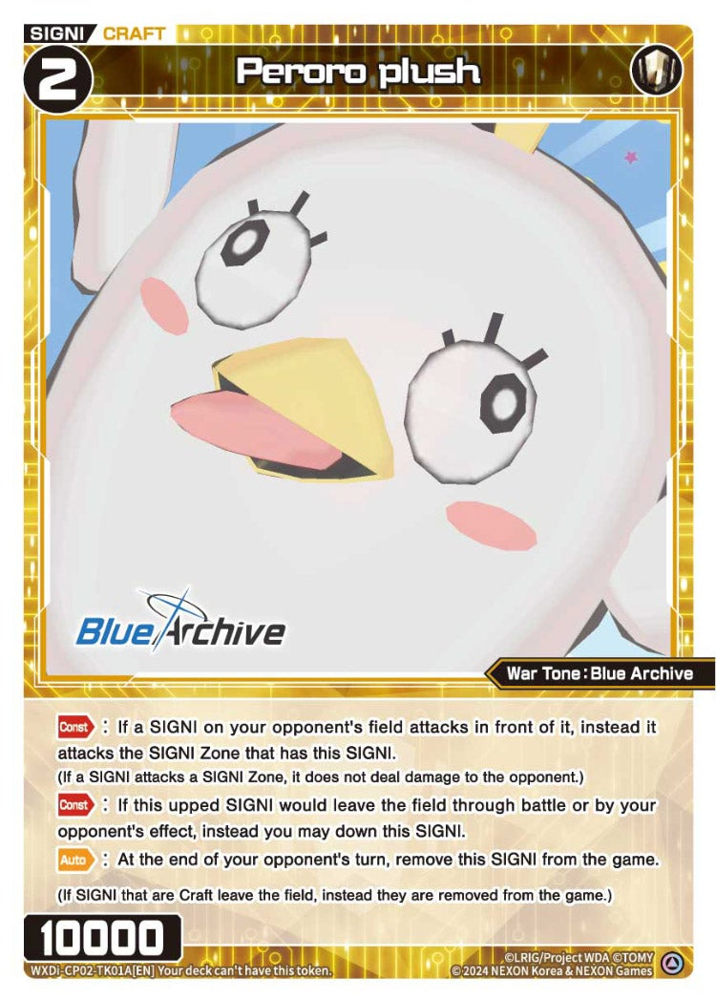

# Peroro plush

## Thông tin lá

| Trường | Giá trị |
| --- | --- |
| Mã in | WXDi-CP02-TK01A[EN] |
| Set | WXDi-CP02[EN] |
| Số thứ tự | TK01A |
| Loại thẻ | SIGNI CRAFT |
| Vị trí | Main Deck |
| Số bản | — (set booster, không áp dụng) |
| Màu | Trắng |
| Độ hiếm | TK,TK(P) |
| Minh họa | — |
| Level | 2 |
| Limit | — |
| Power | 10000 |
| LRIG type / Class | War Tone：Blue Archive |
| Team / Master | — |
| Cost | — |
| Grow cost | — |
| Use timing | — |
| Life Burst | Không |

## Card text chính thức

[Constant]: If a SIGNI on your opponent's field attacks in front of it, instead it attacks the SIGNI Zone that has this SIGNI.
(If a SIGNI attacks a SIGNI Zone, it does not deal damage to the opponent.)
[Constant]: If this upped SIGNI would leave the field through battle or by your opponent's effect, instead you may down this SIGNI.
[Auto]: At the end of your opponent's turn, remove this SIGNI from the game.

(If SIGNI that are Craft leave the field, instead they are removed from the game.)

## Power text / Life Burst

—

## Ghi chú minh họa
Artist: —. Ảnh TK được tải từ Card List tiếng Anh.

## FAQ chính thức

**Q. What is Craft?**
A. Craft is a substitute card that is created during the game by the effect of a card. Please refer to the glossary “Craft” for detailed rules of Craft. Please use the tokens include in the pack when you play. You can also prepare your own markers as long as they are not mixed with other cards and are not designed in a way that is inconvenient for the game.

**Q. What is the second [Const] ability?**
A. If 《Peroro plush》 is upped, when 《Peroro plush》 leaves the field due to battle or opponent's effect, 《Peroro plush》 can be downed to stay on the field. If 《Peroro plush》 is downed, you cannot use this ability. Also, if the power is minus and becomes zero or less power, even if the minus power itself is due to your opponent's effect, the SIGNI vanishes due to the power becoming zero or less power due to the Rule-based Action processing, so this [Const] ability cannot be applied and the 《Peroro plush》 is vanished (it is Craft card, so it is removed from the game).

**Q. What is the first [Const] ability?**
A. All of your opponent's SIGNI will attack the 《Peroro plush》 when they attack.
For example, if you have 《Peroro plush》 in the center SIGNI Zone and your opponent's SIGNI Zone on right or left attacks, your opponent's SIGNI attacks the SIGNI Zone with 《Peroro plush》 in the center. Even if 《Peroro plush》 leaves the field due to its [Auto] ability when it attacks, it still attacks the SIGNI Zone, so the attack cannot damage you.

## Ảnh biến thể

- [TK](../images/WXDi-CP02-TK01AP-EN.jpg)

## Nguồn
[Card List/FAQ chính thức](https://www.takaratomy.co.jp/products/en.wixoss/card/card.html?card_no=WXDi-CP02-TK01A%5BEN%5D ) · [Ảnh thẻ](https://www.takaratomy.co.jp/products/en.wixoss/card/thumb/WXDi-CP02-TK01A%5BEN%5D.jpg)
