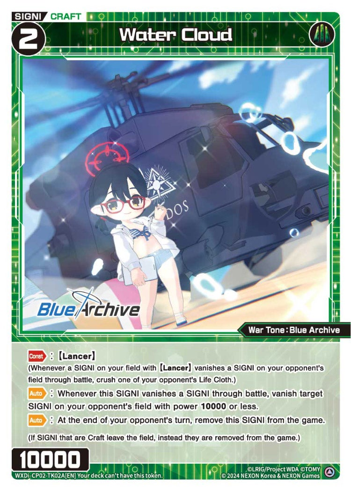

# Water Cloud

## Thông tin lá

| Trường | Giá trị |
| --- | --- |
| Mã in | WXDi-CP02-TK02A[EN] |
| Set | WXDi-CP02[EN] |
| Số thứ tự | TK02A |
| Loại thẻ | SIGNI CRAFT |
| Vị trí | Main Deck |
| Số bản | — (set booster, không áp dụng) |
| Màu | Xanh lá |
| Độ hiếm | TK,TK(P) |
| Minh họa | — |
| Level | 2 |
| Limit | — |
| Power | 10000 |
| LRIG type / Class | War Tone：Blue Archive |
| Team / Master | — |
| Cost | — |
| Grow cost | — |
| Use timing | — |
| Life Burst | Không |

## Card text chính thức

[Constant]: 【Lancer】
(Whenever a SIGNI on your field with 【Lancer】 vanishes a SIGNI on your opponent's field through battle, crush one of your opponent's Life Cloth.)
[Auto]: Whenever this SIGNI vanishes a SIGNI through battle, vanish target SIGNI on your opponent's field with power 10000 or less.
[Auto]: At the end of your opponent's turn, remove this SIGNI from the game.

(If SIGNI that are Craft leave the field, instead they are removed from the game.)

## Power text / Life Burst

—

## Ghi chú minh họa
Artist: —. Ảnh TK được tải từ Card List tiếng Anh.

## FAQ chính thức

**Q. What is Craft?**
A. Craft is a substitute card that is created during the game by the effect of a card. Please refer to the glossary “Craft” for detailed rules of Craft. Please use the tokens include in the pack when you play. You can also prepare your own markers as long as they are not mixed with other cards and are not designed in a way that is inconvenient for the game.

**Q. When 《Water Cloud》 vanishes a SIGNI by battle, which is triggered first, [Lancer] or [Auto] ability?**
A. They are both trigger abilities, so they can be triggered in any order.

**Q. May I target 《Water Cloud》 by the [Action] ability of 《Carnival//Memoria, Galactic Queen》?**
A. Yes, you can. In that case, 《Carnival//Memoria, Galactic Queen》 becomes the same card as 《Water Cloud》 (it inherits all the information listed), but it does not inherit the information whether the target SIGNI is a “card” or “not a card”.
The 《Carnival//Memoria, Galactic Queen》 is still a card even after using its ability, and when it leaves the field, it behaves the same way as a normal “card for SIGNI” leaves the field. (It is not excluded like a Claft SIGNI).

## Ảnh biến thể

- [TK](../images/WXDi-CP02-TK02AP-EN.jpg)

## Nguồn
[Card List/FAQ chính thức](https://www.takaratomy.co.jp/products/en.wixoss/card/card.html?card_no=WXDi-CP02-TK02A%5BEN%5D ) · [Ảnh thẻ](https://www.takaratomy.co.jp/products/en.wixoss/card/thumb/WXDi-CP02-TK02A%5BEN%5D.jpg)
