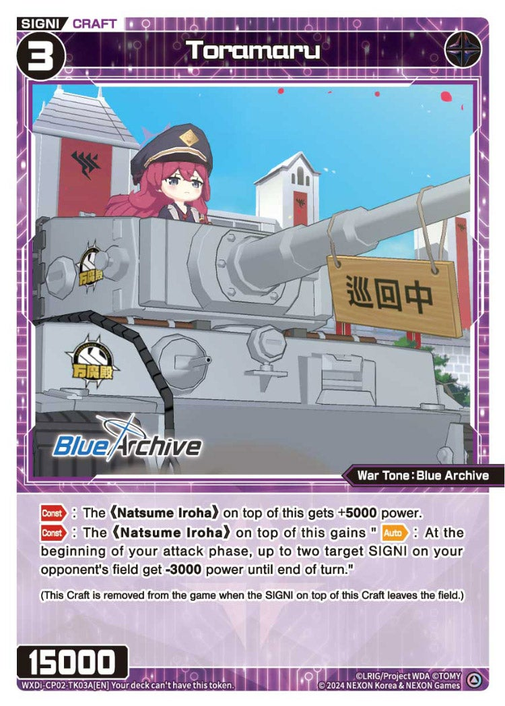

# Toramaru

## Thông tin lá

| Trường | Giá trị |
| --- | --- |
| Mã in | WXDi-CP02-TK03A[EN] |
| Set | WXDi-CP02[EN] |
| Số thứ tự | TK03A |
| Loại thẻ | SIGNI CRAFT |
| Vị trí | Main Deck |
| Số bản | — (set booster, không áp dụng) |
| Màu | Đen |
| Độ hiếm | TK,TK(P) |
| Minh họa | — |
| Level | 3 |
| Limit | — |
| Power | 15000 |
| LRIG type / Class | War Tone：Blue Archive |
| Team / Master | — |
| Cost | — |
| Grow cost | — |
| Use timing | — |
| Life Burst | Không |

## Card text chính thức

[Constant]: The 《Natsume Iroha》 on top of this gets +5000 power.
[Constant]: The 《Natsume Iroha》 on top of this gains "[Auto]: At the beginning of your attack phase, up to two target SIGNI on your opponent's field get -3000 power until end of turn."

(This Craft is removed from the game when the SIGNI on top of this Craft leaves the field.)

## Power text / Life Burst

—

## Ghi chú minh họa
Artist: —. Ảnh TK được tải từ Card List tiếng Anh.

## FAQ chính thức

**Q. What is Craft?**
A. Craft is a substitute card that is created during the game by the effect of a card. Please refer to the glossary “Craft” for detailed rules of Craft. Please use the tokens include in the pack when you play. You can also prepare your own markers as long as they are not mixed with other cards and are not designed in a way that is inconvenient for the game.

## Ảnh biến thể

- [TK](../images/WXDi-CP02-TK03AP-EN.jpg)

## Nguồn
[Card List/FAQ chính thức](https://www.takaratomy.co.jp/products/en.wixoss/card/card.html?card_no=WXDi-CP02-TK03A%5BEN%5D ) · [Ảnh thẻ](https://www.takaratomy.co.jp/products/en.wixoss/card/thumb/WXDi-CP02-TK03A%5BEN%5D.jpg)
