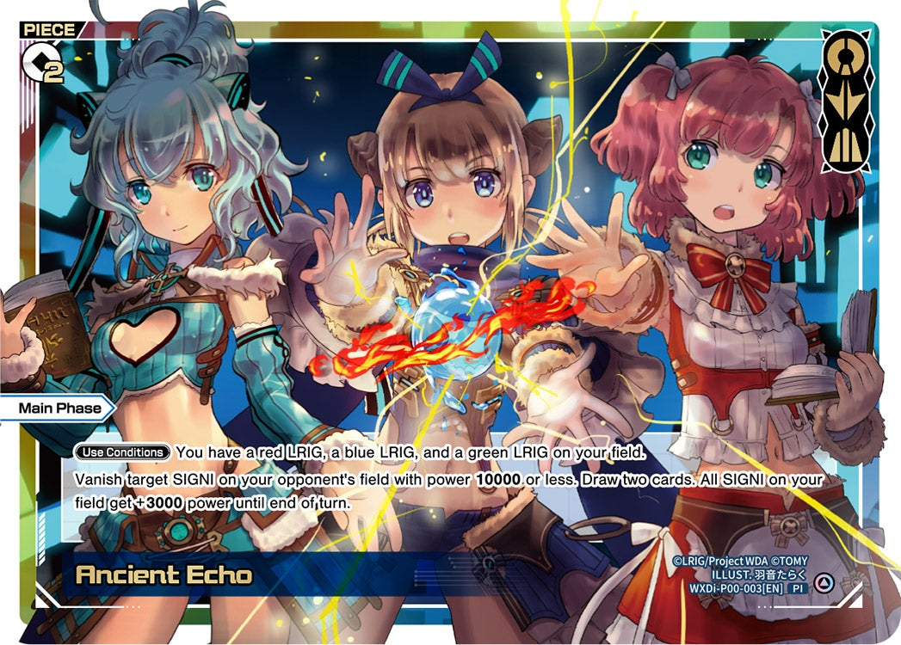

# Ancient Echo

## Thông tin lá

| Trường | Giá trị |
| --- | --- |
| Mã in | WXDi-P00-003[EN] |
| Set | WXDi-P00[EN] |
| Số thứ tự | 003 |
| Loại thẻ | PIECE |
| Vị trí | LRIG Deck |
| Số bản | — (set booster, không áp dụng) |
| Màu | Xanh dương / đỏ / xanh lá |
| Độ hiếm | PI |
| Minh họa | 羽音たらく |
| Level | — |
| Limit | — |
| Power | 0 |
| LRIG type / Class | — |
| Team / Master | — |
| Cost | 《C》×２ |
| Grow cost | — |
| Use timing | Main Phase |
| Life Burst | Không |

## Card text chính thức

[Use Conditions] You have a red LRIG, a blue LRIG, and a green LRIG on your field.

Vanish target SIGNI on your opponent's field with power 10000 or less. Draw two cards. All SIGNI on your field get +3000 power until end of turn.

## Power text / Life Burst

—

## Ghi chú minh họa
Artist: 羽音たらく. Ảnh PI được tải từ Card List tiếng Anh.

## FAQ chính thức

**Q. Can I draw 2 cards even if there is no SIGNI with power 10000 or less in my opponent's field?**
A. Yes, you can, and even if you fail to target the SIGNI of the opponent, the latter effect will still be processed.

**Q. Does the SIGNI I put on my field after using this PIECE get +3000?**
A. No, only the SIGNI in your field when you use this PIECE will be +3000. It does not affect SIGNI that you put on the field later.

## Nguồn
[Card List/FAQ chính thức](https://www.takaratomy.co.jp/products/en.wixoss/card/card.html?card_no=WXDi-P00-003%5BEN%5D ) · [Ảnh thẻ](https://www.takaratomy.co.jp/products/en.wixoss/card/thumb/WXDi-P00-003%5BEN%5D.jpg)
