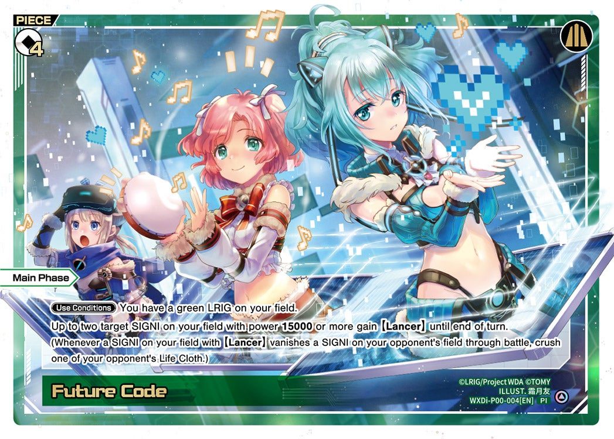

# Future Code

## Thông tin lá

| Trường | Giá trị |
| --- | --- |
| Mã in | WXDi-P00-004[EN] |
| Set | WXDi-P00[EN] |
| Số thứ tự | 004 |
| Loại thẻ | PIECE |
| Vị trí | LRIG Deck |
| Số bản | — (set booster, không áp dụng) |
| Màu | Xanh lá |
| Độ hiếm | PI |
| Minh họa | 霜月友 |
| Level | — |
| Limit | — |
| Power | 0 |
| LRIG type / Class | — |
| Team / Master | — |
| Cost | 《C》×４ |
| Grow cost | — |
| Use timing | Main Phase |
| Life Burst | Không |

## Card text chính thức

[Use Conditions] You have a green LRIG on your field.

Up to two target SIGNI on your field with power 15000 or more gain 【Lancer】 until end of turn.
(Whenever a SIGNI on your field with 【Lancer】 vanishes a SIGNI on your opponent's field through battle, crush one of your opponent's Life Cloth.)

## Power text / Life Burst

—

## Ghi chú minh họa
Artist: 霜月友. Ảnh PI được tải từ Card List tiếng Anh.

## FAQ chính thức

**Q. I have a SIGNI with more than 15000 power gaining [Lancer] with this PIECE. During the same turn, if the power of that SIGNI is reduced to lower than 15000, what happens to the [Lancer] of this SIGNI?**
A. Even if the power is lower than 15000, your SIGNI will still gain [Lancer] for the rest of the turn. Whether or not the power is over 15000 is only checked when you target it with this effect, and it does not affect thereafter.

## Nguồn
[Card List/FAQ chính thức](https://www.takaratomy.co.jp/products/en.wixoss/card/card.html?card_no=WXDi-P00-004%5BEN%5D ) · [Ảnh thẻ](https://www.takaratomy.co.jp/products/en.wixoss/card/thumb/WXDi-P00-004%5BEN%5D.jpg)
