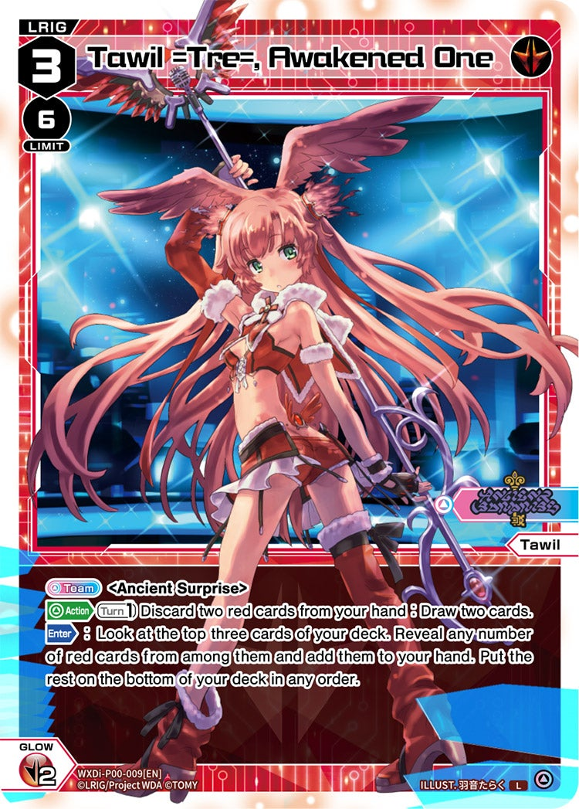

# Tawil =Tre=, Awakened One

## Thông tin lá

| Trường | Giá trị |
| --- | --- |
| Mã in | WXDi-P00-009[EN] |
| Set | WXDi-P00[EN] |
| Số thứ tự | 009 |
| Loại thẻ | LRIG |
| Vị trí | LRIG Deck |
| Số bản | — (set booster, không áp dụng) |
| Màu | Đỏ |
| Độ hiếm | L,SCR,DiR |
| Minh họa | 羽音たらく |
| Level | 3 |
| Limit | 6 |
| Power | 0 |
| LRIG type / Class | Tawil |
| Team / Master | Ancient Surprise |
| Cost | — |
| Grow cost | 《R》×２ |
| Use timing | — |
| Life Burst | Không |

## Card text chính thức

[Team] <Ancient Surprise>
[Team Action] {1/Turn} Discard two red cards from your hand: Draw two cards.
[Enter]: Look at the top three cards of your deck. Reveal any number of red cards from among them and add them to your hand. Put the rest on the bottom of your deck in any order.

## Power text / Life Burst

—

## Ghi chú minh họa
Artist: 羽音たらく. Ảnh L được tải từ Card List tiếng Anh.

## FAQ chính thức

**Q. What does it mean by [Team]?**
A. It means the team indicated by that card. The [Team Auto], [Team Action], [Team Constant], and [Team Enter] abilities of the card are valid only if all 3 LRIGs in your field are the indicated [Team].
In the case of this card, if all three of your LRIGs are <ANCIENT SURPRISE>, you will be able to use the [Team Action] ability.

**Q. When I paid cost for [Team Action] ability, I had only one card in my hand. Can I discard that one card and draw two cards?**
A. No, you can't. If you don't have enough cards in your hand to discard as cost, you can't discard any cards and you can't activate the effect.

**Q. Can I discard 《Servant #》as a red card for [Team Action]'s cost?**
A. No, you can't. [Multi Ener] is an ability that only works when you paying Ener costs. So, you can't discard it as a red card.

## Ảnh biến thể

- [DiR](../images/WXDi-P00-009D-EN.jpg)
- [SCR](../images/WXDi-P00-009S-EN.jpg)

## Nguồn
[Card List/FAQ chính thức](https://www.takaratomy.co.jp/products/en.wixoss/card/card.html?card_no=WXDi-P00-009%5BEN%5D ) · [Ảnh thẻ](https://www.takaratomy.co.jp/products/en.wixoss/card/thumb/WXDi-P00-009%5BEN%5D.jpg)
