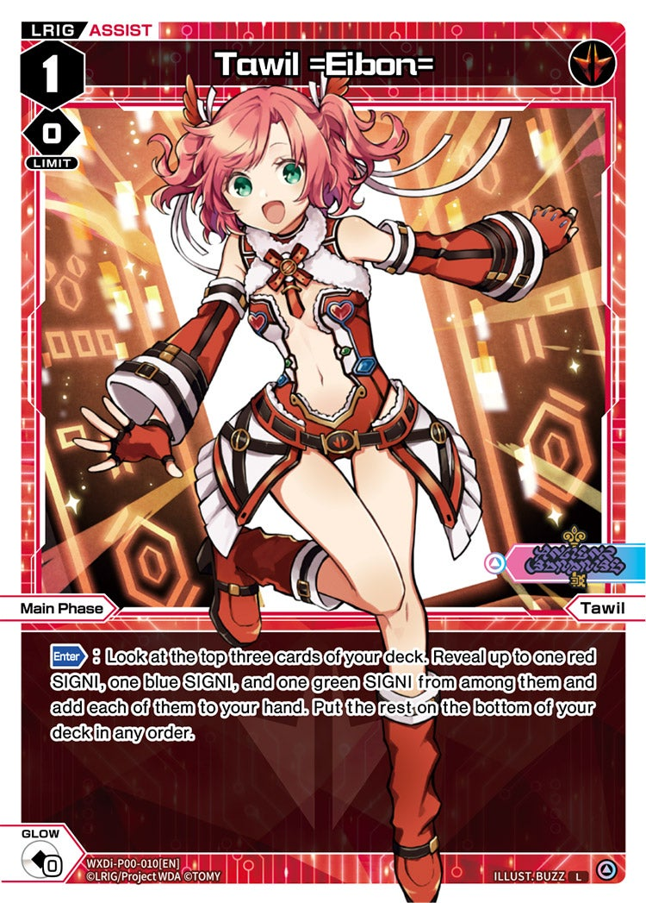

# Tawil =Eibon=

## Thông tin lá

| Trường | Giá trị |
| --- | --- |
| Mã in | WXDi-P00-010[EN] |
| Set | WXDi-P00[EN] |
| Số thứ tự | 010 |
| Loại thẻ | ASSIST LRIG |
| Vị trí | LRIG Deck |
| Số bản | — (set booster, không áp dụng) |
| Màu | Đỏ |
| Độ hiếm | L,L(P) |
| Minh họa | BUZZ |
| Level | 1 |
| Limit | 0 |
| Power | 0 |
| LRIG type / Class | Tawil |
| Team / Master | Ancient Surprise |
| Cost | — |
| Grow cost | 《C》×０ |
| Use timing | Main Phase |
| Life Burst | Không |

## Card text chính thức

[Enter]: Look at the top three cards of your deck. Reveal up to one red SIGNI, one blue SIGNI, and one green SIGNI from among them and add each of them to your hand. Put the rest on the bottom of your deck in any order.

## Power text / Life Burst

—

## Ghi chú minh họa
Artist: BUZZ. Ảnh L được tải từ Card List tiếng Anh.

## FAQ chính thức

**Q. Can I add 《Bronze, Natural Crystal》, which is both red and blue, to my hand with this [Enter]?**
A. Yes, you can. In that case, 《Bronze, Natural Crystal》 can be revealed as a red SIGNI or a blue SIGNI. For example, if you reveal it as a red SIGNI, you can also reveal one blue SIGNI and one green SIGNI, and add them to your hand.

## Ảnh biến thể

- [L(P)](../images/WXDi-P00-010P-EN.jpg)

## Nguồn
[Card List/FAQ chính thức](https://www.takaratomy.co.jp/products/en.wixoss/card/card.html?card_no=WXDi-P00-010%5BEN%5D ) · [Ảnh thẻ](https://www.takaratomy.co.jp/products/en.wixoss/card/thumb/WXDi-P00-010%5BEN%5D.jpg)
