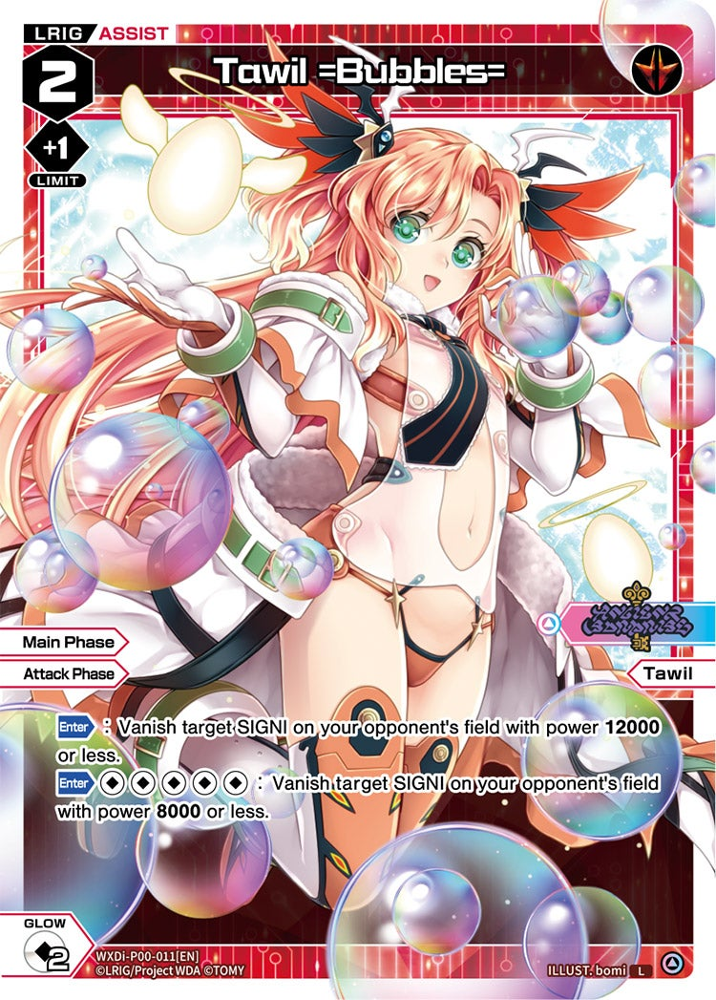

# Tawil =Bubbles=

## Thông tin lá

| Trường | Giá trị |
| --- | --- |
| Mã in | WXDi-P00-011[EN] |
| Set | WXDi-P00[EN] |
| Số thứ tự | 011 |
| Loại thẻ | ASSIST LRIG |
| Vị trí | LRIG Deck |
| Số bản | — (set booster, không áp dụng) |
| Màu | Đỏ |
| Độ hiếm | L,L(P) |
| Minh họa | bomi |
| Level | 2 |
| Limit | ＋１ |
| Power | 0 |
| LRIG type / Class | Tawil |
| Team / Master | Ancient Surprise |
| Cost | — |
| Grow cost | 《C》×２ |
| Use timing | Main Phase
Attack Phase |
| Life Burst | Không |

## Card text chính thức

[Enter]: Vanish target SIGNI on your opponent's field with power 12000 or less.
[Enter] {Colorless} {Colorless} {Colorless} {Colorless} {Colorless}: Vanish target SIGNI on your opponent's field with power 8000 or less.

## Power text / Life Burst

—

## Ghi chú minh họa
Artist: bomi. Ảnh L được tải từ Card List tiếng Anh.

## FAQ chính thức

**Q. Does the bottom [Enter] always have to be triggered if cost is payable?**
A. No. [Enter] with cost can choose to pay cost to activate or not.

## Ảnh biến thể

- [L(P)](../images/WXDi-P00-011P-EN.jpg)

## Nguồn
[Card List/FAQ chính thức](https://www.takaratomy.co.jp/products/en.wixoss/card/card.html?card_no=WXDi-P00-011%5BEN%5D ) · [Ảnh thẻ](https://www.takaratomy.co.jp/products/en.wixoss/card/thumb/WXDi-P00-011%5BEN%5D.jpg)
