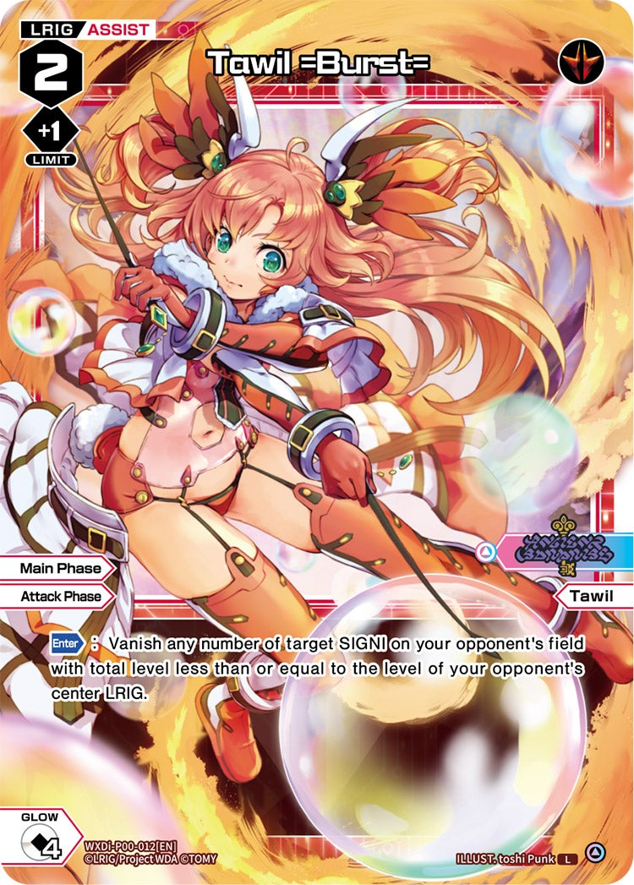

# Tawil =Burst=

## Thông tin lá

| Trường | Giá trị |
| --- | --- |
| Mã in | WXDi-P00-012[EN] |
| Set | WXDi-P00[EN] |
| Số thứ tự | 012 |
| Loại thẻ | ASSIST LRIG |
| Vị trí | LRIG Deck |
| Số bản | — (set booster, không áp dụng) |
| Màu | Đỏ |
| Độ hiếm | L,L(P) |
| Minh họa | toshi Punk |
| Level | 2 |
| Limit | ＋１ |
| Power | 0 |
| LRIG type / Class | Tawil |
| Team / Master | Ancient Surprise |
| Cost | — |
| Grow cost | 《C》×４ |
| Use timing | Main Phase
Attack Phase |
| Life Burst | Không |

## Card text chính thức

[Enter]: Vanish any number of target SIGNI on your opponent's field with total level less than or equal to the level of your opponent's center LRIG.

## Power text / Life Burst

—

## Ghi chú minh họa
Artist: toshi Punk. Ảnh L được tải từ Card List tiếng Anh.

## FAQ chính thức

**Q. If my opponent's Center LRIG is level 3, how many SIGNI can I vanish at most?**
A. In that case, the following pattern is possible.
So, you can vanish up to 3 SIGNI.
1).Vanish a level 3 SIGNI
2).Vanish a level 2 SIGNI and a level 1 SIGNI
3).Vanish three level 1 SIGNI.

## Ảnh biến thể

- [L(P)](../images/WXDi-P00-012P-EN.jpg)

## Nguồn
[Card List/FAQ chính thức](https://www.takaratomy.co.jp/products/en.wixoss/card/card.html?card_no=WXDi-P00-012%5BEN%5D ) · [Ảnh thẻ](https://www.takaratomy.co.jp/products/en.wixoss/card/thumb/WXDi-P00-012%5BEN%5D.jpg)
