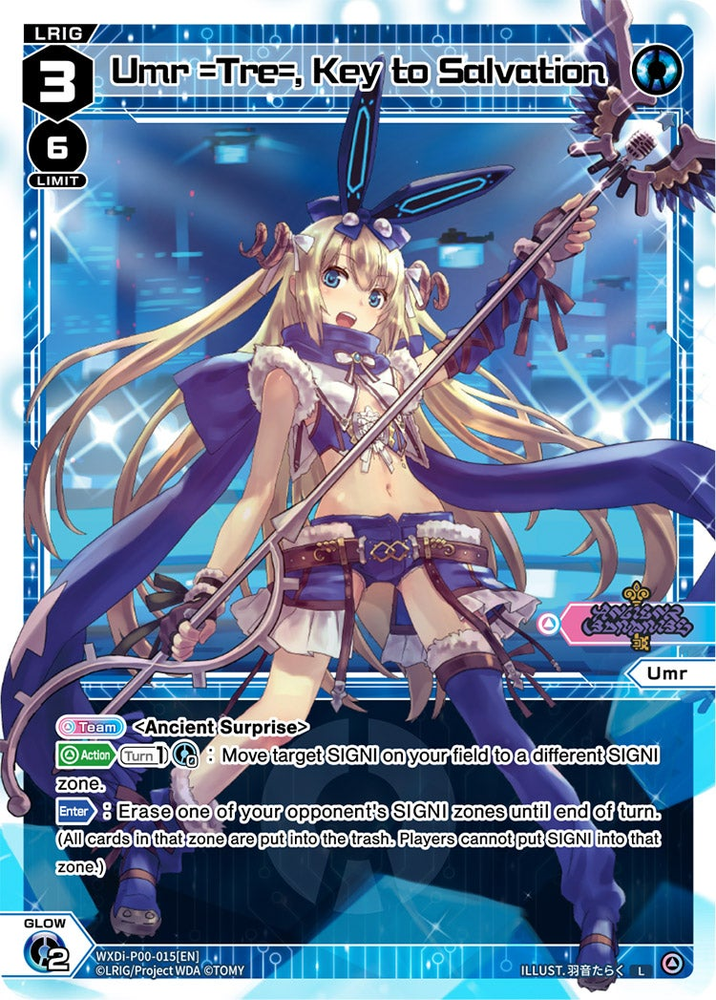

# Umr =Tre=, Key to Salvation

## Thông tin lá

| Trường | Giá trị |
| --- | --- |
| Mã in | WXDi-P00-015[EN] |
| Set | WXDi-P00[EN] |
| Số thứ tự | 015 |
| Loại thẻ | LRIG |
| Vị trí | LRIG Deck |
| Số bản | — (set booster, không áp dụng) |
| Màu | Xanh dương |
| Độ hiếm | L,SCR,DiR |
| Minh họa | 羽音たらく |
| Level | 3 |
| Limit | 6 |
| Power | 0 |
| LRIG type / Class | Umr |
| Team / Master | Ancient Surprise |
| Cost | — |
| Grow cost | 《U》×２ |
| Use timing | — |
| Life Burst | Không |

## Card text chính thức

[Team] <Ancient Surprise>
[Team Action] {1/Turn} {Bluex0}: Move target SIGNI on your field to a different SIGNI zone.
[Enter]: Erase one of your opponent's SIGNI zones until end of turn. (All cards in that zone are put into the trash. Players cannot put SIGNI into that zone.)

## Power text / Life Burst

—

## Ghi chú minh họa
Artist: 羽音たらく. Ảnh L được tải từ Card List tiếng Anh.

## FAQ chính thức

**Q. What does it mean by [Team]?**
A. It means the team indicated by that card. The [Team Auto], [Team Action], [Team Constant], and [Team Enter] abilities of the card are valid only if all 3 LRIGs in your field are the indicated [Team].
In the case of this card, if all three of your LRIGs are <ANCIENT SURPRISE>, you will be able to use the [Team Action] ability.

**Q. Can I use the [Team Action] ability to move one of my SIGNI into a SIGNI zone that already has another SIGNI in it?**
A. No, if there is already a SIGNI at the place you want to move to, you will not be able to place it and will stay in the SIGNI zone before the move.

**Q. One of opponent's SIGNI zones is erased by [Enter] ability.
What happens if I attack with the SIGNI in front of it?**
A. There is no SIGNI in front of it, so it will damage the opponent.

**Q. My opponent's SIGNI Zone was erased by [Enter], and the cards in the SIGNI Zone were placed in the Trash. Will the cards placed in the Trash be returned at the end of the turn?**
A. No, they will not be returned.

**Q. If there is a SIGNI in the SIGNI zone that is erased by [Enter] and has the ability "when ~ leaves the field" or "When~into trash", will that ability trigger?**
A. Yes, that ability will be triggered.

**Q. If I use [Enter] to erase the right SIGNI zone, will the center SIGNI zone no longer be centered?**
A. No, even if the right SIGNI zone is erased, the remaining SIGNI zones remain the left SIGNI zone and the center SIGNI zone.
For example, the effect of "Kaede Higuchi, Code 2434", which adds the power of SIGNI in the center SIGNI zone, will still add the power of SIGNI in the center SIGNI zone after the right SIGNI zone is erased.

## Ảnh biến thể

- [DiR](../images/WXDi-P00-015D-EN.jpg)
- [SCR](../images/WXDi-P00-015S-EN.jpg)

## Nguồn
[Card List/FAQ chính thức](https://www.takaratomy.co.jp/products/en.wixoss/card/card.html?card_no=WXDi-P00-015%5BEN%5D ) · [Ảnh thẻ](https://www.takaratomy.co.jp/products/en.wixoss/card/thumb/WXDi-P00-015%5BEN%5D.jpg)
