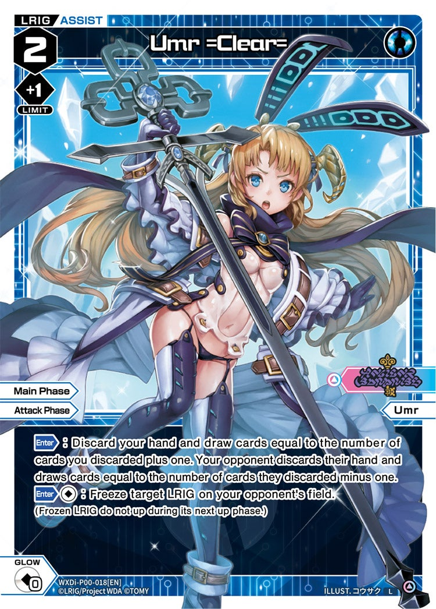

# Umr =Clear=

## Thông tin lá

| Trường | Giá trị |
| --- | --- |
| Mã in | WXDi-P00-018[EN] |
| Set | WXDi-P00[EN] |
| Số thứ tự | 018 |
| Loại thẻ | ASSIST LRIG |
| Vị trí | LRIG Deck |
| Số bản | — (set booster, không áp dụng) |
| Màu | Xanh dương |
| Độ hiếm | L,L(P) |
| Minh họa | コウサク |
| Level | 2 |
| Limit | ＋１ |
| Power | 0 |
| LRIG type / Class | Umr |
| Team / Master | Ancient Surprise |
| Cost | — |
| Grow cost | 《C》×０ |
| Use timing | Main Phase / Attack Phase |
| Life Burst | Không |

## Card text chính thức

[Enter]: Discard your hand and draw cards equal to the number of cards you discarded plus one. Your opponent discards their hand and draws cards equal to the number of cards they discarded minus one.
[Enter] {Colorless}: Freeze target LRIG on your opponent's field.
 (Frozen LRIG do not up during its next up phase.)

## Power text / Life Burst

—

## Ghi chú minh họa
Artist: コウサク. Ảnh L được tải từ Card List tiếng Anh.

## FAQ chính thức

**Q. When I activated [Enter] on the upper side, I did not have any cards in my hand. Can you draw a card?**
A. Yes, it will be processed as if you added 1 to 0 cards.
As a result, you can draw a card.

## Ảnh biến thể

- [L(P)](../images/WXDi-P00-018P-EN.jpg)

## Nguồn
[Card List/FAQ chính thức](https://www.takaratomy.co.jp/products/en.wixoss/card/card.html?card_no=WXDi-P00-018%5BEN%5D ) · [Ảnh thẻ](https://www.takaratomy.co.jp/products/en.wixoss/card/thumb/WXDi-P00-018%5BEN%5D.jpg)
