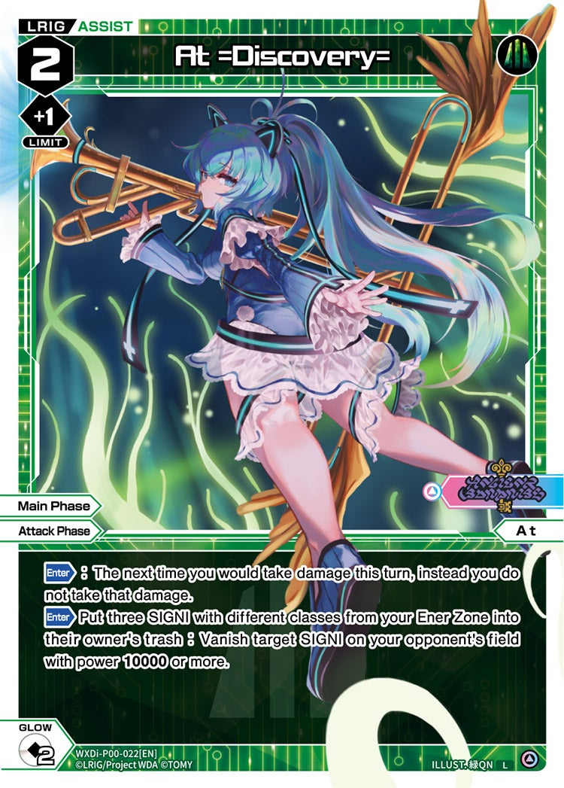

# At =Discovery=

## Thông tin lá

| Trường | Giá trị |
| --- | --- |
| Mã in | WXDi-P00-022[EN] |
| Set | WXDi-P00[EN] |
| Số thứ tự | 022 |
| Loại thẻ | ASSIST LRIG |
| Vị trí | LRIG Deck |
| Số bản | — (set booster, không áp dụng) |
| Màu | Xanh lá |
| Độ hiếm | L,L(P) |
| Minh họa | 緑QN |
| Level | 2 |
| Limit | ＋１ |
| Power | 0 |
| LRIG type / Class | At |
| Team / Master | Ancient Surprise |
| Cost | — |
| Grow cost | 《C》×２ |
| Use timing | Main Phase
Attack Phase |
| Life Burst | Không |

## Card text chính thức

[Enter]: The next time you would take damage this turn, instead you do not take that damage.
[Enter] Put three SIGNI with different classes from your Ener Zone into their owner's trash: Vanish target SIGNI on your opponent's field with power 10000 or more.

## Power text / Life Burst

—

## Ghi chú minh họa
Artist: 緑QN. Ảnh L được tải từ Card List tiếng Anh.

## FAQ chính thức

**Q. After activating [Enter] above, attacked by a SIGNI with [Double Crush].
How many Life Cloths will be crushed?**
A. Not even one card is crushed. [Double Crush] is an effect that causes two Life Cloths to be crushed instead of one when an attack deals one damage, but this [Enter] prevents that one damage.

## Ảnh biến thể

- [L(P)](../images/WXDi-P00-022P-EN.jpg)

## Nguồn
[Card List/FAQ chính thức](https://www.takaratomy.co.jp/products/en.wixoss/card/card.html?card_no=WXDi-P00-022%5BEN%5D ) · [Ảnh thẻ](https://www.takaratomy.co.jp/products/en.wixoss/card/thumb/WXDi-P00-022%5BEN%5D.jpg)
