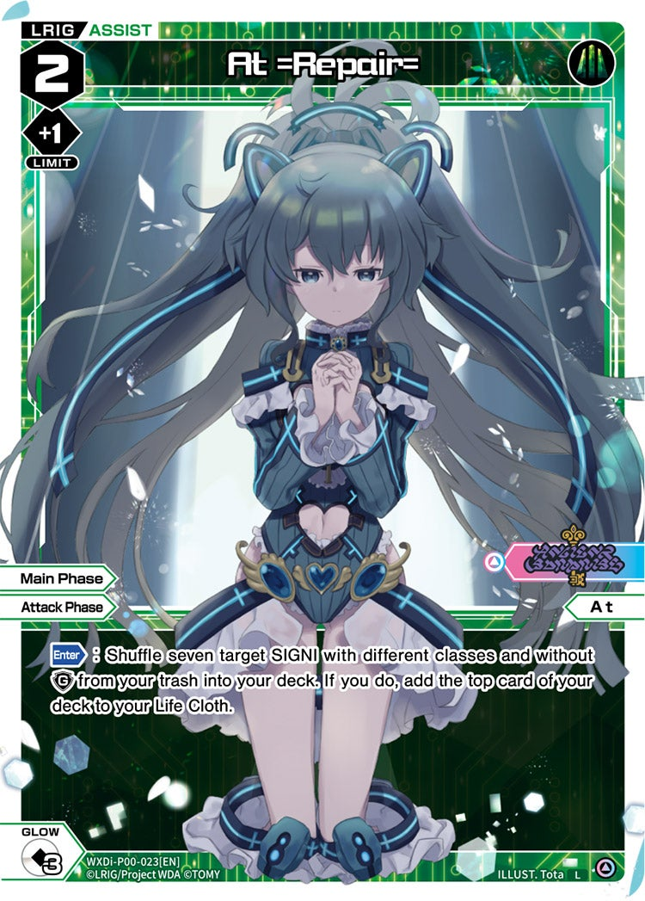

# At =Repair=

## Thông tin lá

| Trường | Giá trị |
| --- | --- |
| Mã in | WXDi-P00-023[EN] |
| Set | WXDi-P00[EN] |
| Số thứ tự | 023 |
| Loại thẻ | ASSIST LRIG |
| Vị trí | LRIG Deck |
| Số bản | — (set booster, không áp dụng) |
| Màu | Xanh lá |
| Độ hiếm | L,L(P) |
| Minh họa | Tota |
| Level | 2 |
| Limit | ＋１ |
| Power | 0 |
| LRIG type / Class | At |
| Team / Master | Ancient Surprise |
| Cost | — |
| Grow cost | 《C》×３ |
| Use timing | Main Phase / Attack Phase |
| Life Burst | Không |

## Card text chính thức

[Enter]: Shuffle seven target SIGNI with different classes and without {Guard Icon} from your trash into your deck. If you do, add the top card of your deck to your Life Cloth.

## Power text / Life Burst

—

## Ghi chú minh họa
Artist: Tota. Ảnh L được tải từ Card List tiếng Anh.

## FAQ chính thức

**Q. If I have 6 SIGNI in my Trash that match the requirements, can I add them to my deck?**
A. No. If the requested 7 cards cannot be targeted, none of them can be returned to the deck.

## Ảnh biến thể

- [L(P)](../images/WXDi-P00-023P-EN.jpg)

## Nguồn
[Card List/FAQ chính thức](https://www.takaratomy.co.jp/products/en.wixoss/card/card.html?card_no=WXDi-P00-023%5BEN%5D ) · [Ảnh thẻ](https://www.takaratomy.co.jp/products/en.wixoss/card/thumb/WXDi-P00-023%5BEN%5D.jpg)
