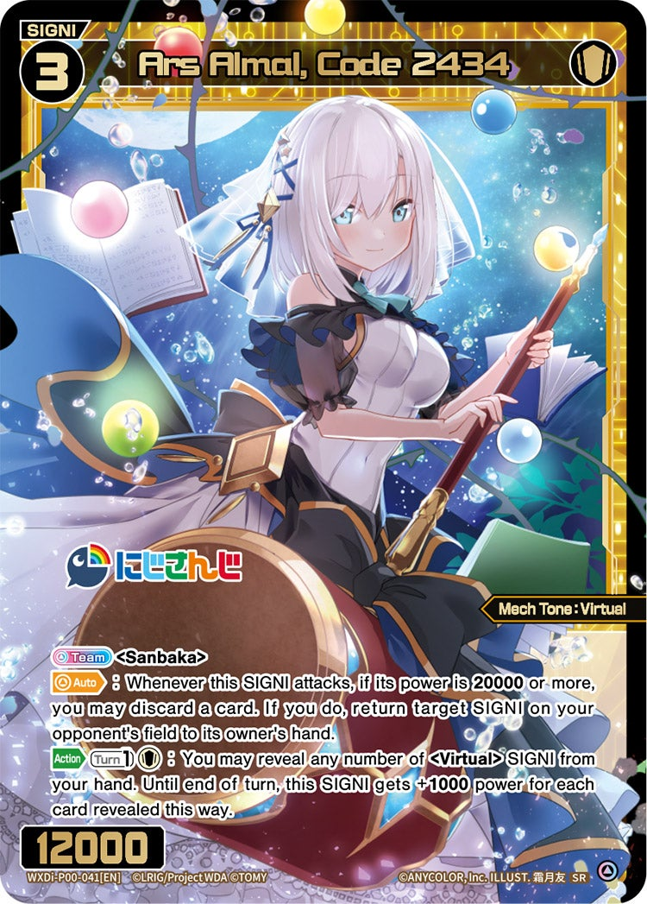

# Ars Almal, Code 2434

## Thông tin lá

| Trường | Giá trị |
| --- | --- |
| Mã in | WXDi-P00-041[EN] |
| Set | WXDi-P00[EN] |
| Số thứ tự | 041 |
| Loại thẻ | SIGNI |
| Vị trí | Main Deck |
| Số bản | — (set booster, không áp dụng) |
| Màu | Trắng |
| Độ hiếm | SR,SCR |
| Minh họa | 霜月友 |
| Level | 3 |
| Limit | — |
| Power | 12000 |
| LRIG type / Class | Mech Tone：Virtual |
| Team / Master | — |
| Cost | — |
| Grow cost | — |
| Use timing | — |
| Life Burst | Không |

## Card text chính thức

[Team] <Sanbaka>
[Team Auto]: Whenever this SIGNI attacks, if its power is 20000 or more, you may discard a card. If you do, return target SIGNI on your opponent's field to its owner's hand.
[Action] {1/Turn} {White}: You may reveal any number of <Virtual> SIGNI from your hand. Until end of turn, this SIGNI gets +1000 power for each card revealed this way.

## Power text / Life Burst

—

## Ghi chú minh họa
Artist: 霜月友. Ảnh SR được tải từ Card List tiếng Anh.

## FAQ chính thức

**Q. What does it mean by [Team]?**
A. It means the team indicated by that card. The [Team Auto], [Team Action], [Team Constant], and [Team Enter] abilities of the card are valid only if all 3 LRIGs in your field are the indicated [Team].
In the case of this card, if all three of your LRIGs are <Sanbaka>, you will be able to use the [Team Auto] ability.

**Q. Which card will be returned to hand by [Team Auto] ability?**
A. Targeted, opponent's SIGNI.

## Ảnh biến thể

- [SCR](../images/WXDi-P00-041S-EN.jpg)

## Nguồn
[Card List/FAQ chính thức](https://www.takaratomy.co.jp/products/en.wixoss/card/card.html?card_no=WXDi-P00-041%5BEN%5D ) · [Ảnh thẻ](https://www.takaratomy.co.jp/products/en.wixoss/card/thumb/WXDi-P00-041%5BEN%5D.jpg)
