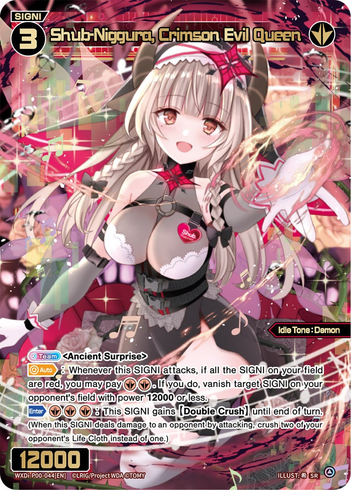

# Shub-Niggura, Crimson Evil Queen

## Thông tin lá

| Trường | Giá trị |
| --- | --- |
| Mã in | WXDi-P00-044[EN] |
| Set | WXDi-P00[EN] |
| Số thứ tự | 044 |
| Loại thẻ | SIGNI |
| Vị trí | Main Deck |
| Số bản | — (set booster, không áp dụng) |
| Màu | Đỏ |
| Độ hiếm | SR |
| Minh họa | 希 |
| Level | 3 |
| Limit | — |
| Power | 12000 |
| LRIG type / Class | Idol Tone：Demon |
| Team / Master | — |
| Cost | — |
| Grow cost | — |
| Use timing | — |
| Life Burst | Không |

## Card text chính thức

[Team] <Ancient Surprise>
[Team Auto]: Whenever this SIGNI attacks, if all the SIGNI on your field are red, you may pay {Red} {Red}. If you do, vanish target SIGNI on your opponent's field with power 12000 or less.
[Enter] {Red} {Red} {Red}: This SIGNI gains 【Double Crush】 until end of turn. (When this SIGNI deals damage to an opponent by attacking, crush two of your opponent's Life Cloth instead of one.)

## Power text / Life Burst

—

## Ghi chú minh họa
Artist: 希. Ảnh SR được tải từ Card List tiếng Anh.

## FAQ chính thức

**Q. What does it mean by [Team]?**
A. It means the team indicated by that card. The [Team Auto], [Team Action], [Team Constant], and [Team Enter] abilities of the card are valid only if all 3 LRIGs in your field are the indicated [Team].
In the case of this card, if all three of your LRIGs are <ANCIENT SURPRISE>, you will be able to use the [Team Auto] ability.

**Q. If I don't have any other SIGNI in my SIGNI zone, does it satisfy the [Team Auto] requirement?**
A. Yes, even if there is only this one SIGNI, it still matches "all the SIGNI on your field are red".

**Q. Does [Team Auto] trigger when there is a red/blue SIGNI on the field, such as 《Bronze, Natural Crystal》?**
A. Yes, 《Bronze, Natural Crystal》 is also a red SIGNI, so it matches the "if all the SIGNI on your field are red,".

## Nguồn
[Card List/FAQ chính thức](https://www.takaratomy.co.jp/products/en.wixoss/card/card.html?card_no=WXDi-P00-044%5BEN%5D ) · [Ảnh thẻ](https://www.takaratomy.co.jp/products/en.wixoss/card/thumb/WXDi-P00-044%5BEN%5D.jpg)
