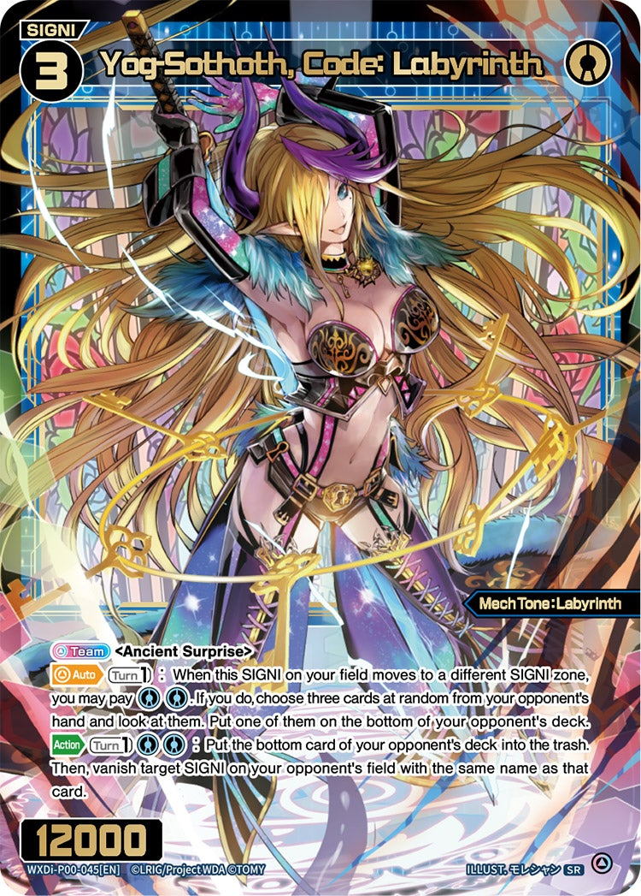

# Yog-Sothoth, Code: Labyrinth

## Thông tin lá

| Trường | Giá trị |
| --- | --- |
| Mã in | WXDi-P00-045[EN] |
| Set | WXDi-P00[EN] |
| Số thứ tự | 045 |
| Loại thẻ | SIGNI |
| Vị trí | Main Deck |
| Số bản | — (set booster, không áp dụng) |
| Màu | Xanh dương |
| Độ hiếm | SR |
| Minh họa | モレシャン |
| Level | 3 |
| Limit | — |
| Power | 12000 |
| LRIG type / Class | Mech Tone：Labyrinth |
| Team / Master | — |
| Cost | — |
| Grow cost | — |
| Use timing | — |
| Life Burst | Không |

## Card text chính thức

[Team] <Ancient Surprise>
[Team Auto] {1/Turn}: When this SIGNI on your field moves to a different SIGNI zone, you may pay {Blue} {Blue}. If you do, choose three cards at random from your opponent's hand and look at them. Put one of them on the bottom of your opponent's deck.
[Action] {1/Turn} {Blue} {Blue}: Put the bottom card of your opponent's deck into the trash. Then, vanish target SIGNI on your opponent's field with the same name as that card.

## Power text / Life Burst

—

## Ghi chú minh họa
Artist: モレシャン. Ảnh SR được tải từ Card List tiếng Anh.

## FAQ chính thức

**Q. What does it mean by [Team]?**
A. It means the team indicated by that card. The [Team Auto], [Team Action], [Team Constant], and [Team Enter] abilities of the card are valid only if all 3 LRIGs in your field are the indicated [Team].
In the case of this card, if all three of your LRIGs are <ANCIENT SURPRISE>, you will be able to use the [Team Auto] ability.

**Q. The correct procedure when using [Action] ability when the opponent has only one card left in his deck.**
A. In that case, the number of cards remaining inthe deck becomes 0 when you put the remaining card in the trash, but the rules process of Refresh will not be done during the processing of the effect. If there is an opponent SIGNI with the same card name, it will be vanished and refresh will be done after the effect is over.

## Nguồn
[Card List/FAQ chính thức](https://www.takaratomy.co.jp/products/en.wixoss/card/card.html?card_no=WXDi-P00-045%5BEN%5D ) · [Ảnh thẻ](https://www.takaratomy.co.jp/products/en.wixoss/card/thumb/WXDi-P00-045%5BEN%5D.jpg)
