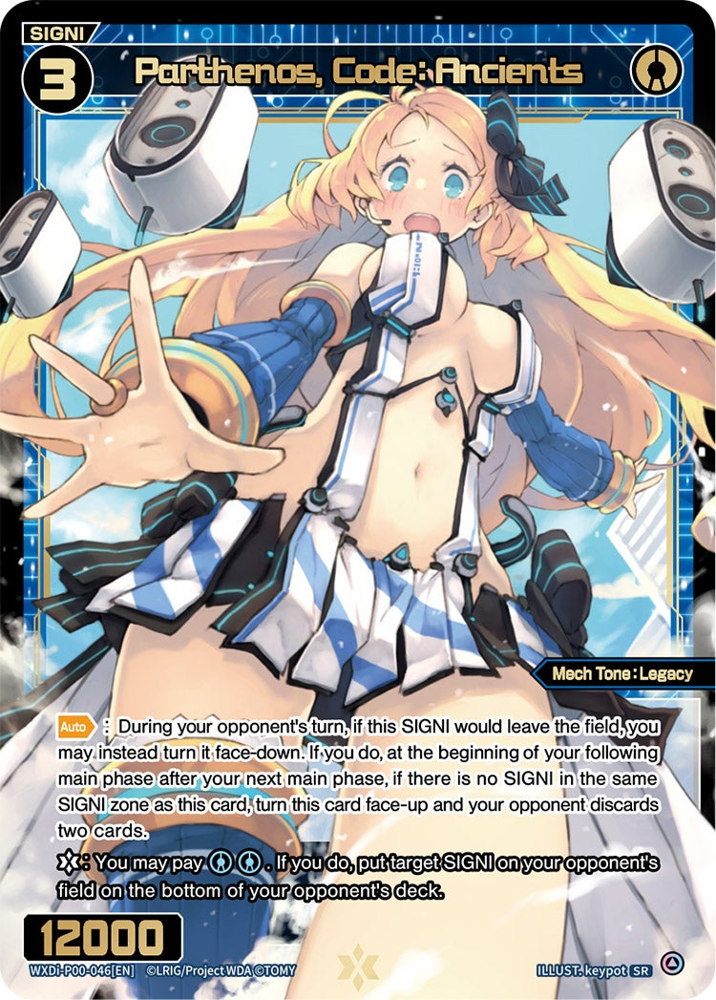

# Parthenos, Code: Ancients

## Thông tin lá

| Trường | Giá trị |
| --- | --- |
| Mã in | WXDi-P00-046[EN] |
| Set | WXDi-P00[EN] |
| Số thứ tự | 046 |
| Loại thẻ | SIGNI |
| Vị trí | Main Deck |
| Số bản | — (set booster, không áp dụng) |
| Màu | Xanh dương |
| Độ hiếm | SR |
| Minh họa | keypot |
| Level | 3 |
| Limit | — |
| Power | 12000 |
| LRIG type / Class | Mech Tone：Legacy |
| Team / Master | — |
| Cost | — |
| Grow cost | — |
| Use timing | — |
| Life Burst | Có |

## Card text chính thức

[Constant]: During your opponent's turn, if this SIGNI would leave the field, you may instead turn it face-down. If you do, at the beginning of your following main phase after your next main phase, if there is no SIGNI in the same SIGNI zone as this card, turn this card face-up and your opponent discards two cards.

## Power text / Life Burst

You may pay {Blue} {Blue}. If you do, put target SIGNI on your opponent's field on the bottom of your opponent's deck.

## Ghi chú minh họa
Artist: keypot. Ảnh SR được tải từ Card List tiếng Anh.

## FAQ chính thức

**Q. Is this card treated as a SIGNI when it is turned face down by [Constant]?**
A. No, it's not a SIGNI, so you can't choose it if it's an effect that vanishes or returns a SIGNI to hand. On the other hand, if the effect is "choose a card and put it in Trash", you can choose it.

**Q. If Opponent has only one card in hand when this SIGNI is turned face up.**
A. In that case, your opponent discard a card.

## Nguồn
[Card List/FAQ chính thức](https://www.takaratomy.co.jp/products/en.wixoss/card/card.html?card_no=WXDi-P00-046%5BEN%5D ) · [Ảnh thẻ](https://www.takaratomy.co.jp/products/en.wixoss/card/thumb/WXDi-P00-046%5BEN%5D.jpg)
