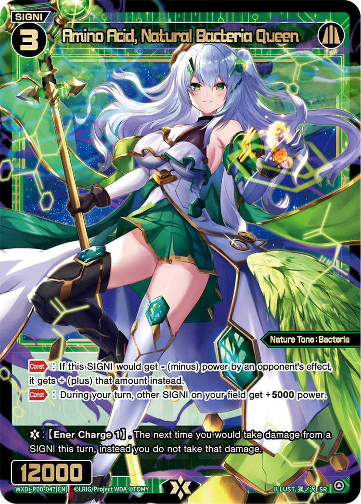

# Amino Acid, Natural Bacteria Queen

## Thông tin lá

| Trường | Giá trị |
| --- | --- |
| Mã in | WXDi-P00-047[EN] |
| Set | WXDi-P00[EN] |
| Số thứ tự | 047 |
| Loại thẻ | SIGNI |
| Vị trí | Main Deck |
| Số bản | — (set booster, không áp dụng) |
| Màu | Xanh lá |
| Độ hiếm | SR |
| Minh họa | 狐ノ沢 |
| Level | 3 |
| Limit | — |
| Power | 12000 |
| LRIG type / Class | Nature Tone：Bacteria |
| Team / Master | — |
| Cost | — |
| Grow cost | — |
| Use timing | — |
| Life Burst | Có |

## Card text chính thức

[Constant]: If this SIGNI would get - (minus) power by an opponent's effect, it gets + (plus) that amount instead.
[Constant]; During your turn, other SIGNI on your field get +5000 power.

## Power text / Life Burst

【Ener Charge 1】. The next time you would take damage from a SIGNI this turn, instead you do not take that damage.

## Ghi chú minh họa
Artist: 狐ノ沢. Ảnh SR được tải từ Card List tiếng Anh.

## FAQ chính thức

**Q. If the opponent attacks with [Lancer] or [Double Crush] after this SIGNI's Life Burst has been activated.**
A. The crush caused by [Lancer] is not a damage crush, but an effect crush, so it will be crushed.

[Double Crush] is the ability to crush two Life Cloths instead of one when dealing damage from an attack, so the damage itself is prevented by the effect of this Life Burst, so it is not crushed.

## Nguồn
[Card List/FAQ chính thức](https://www.takaratomy.co.jp/products/en.wixoss/card/card.html?card_no=WXDi-P00-047%5BEN%5D ) · [Ảnh thẻ](https://www.takaratomy.co.jp/products/en.wixoss/card/thumb/WXDi-P00-047%5BEN%5D.jpg)
