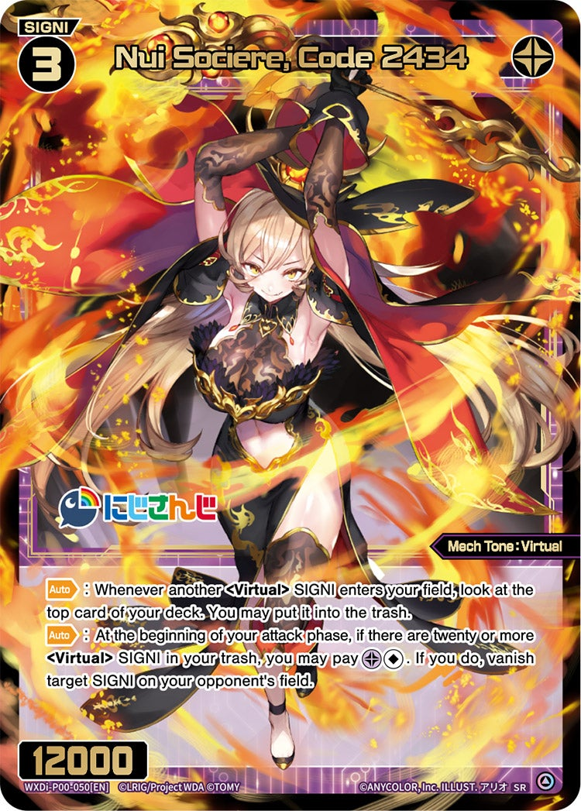

# Nui Sociere, Code 2434

## Thông tin lá

| Trường | Giá trị |
| --- | --- |
| Mã in | WXDi-P00-050[EN] |
| Set | WXDi-P00[EN] |
| Số thứ tự | 050 |
| Loại thẻ | SIGNI |
| Vị trí | Main Deck |
| Số bản | — (set booster, không áp dụng) |
| Màu | Đen |
| Độ hiếm | SR,SCR |
| Minh họa | アリオ |
| Level | 3 |
| Limit | — |
| Power | 12000 |
| LRIG type / Class | Mech Tone：Virtual |
| Team / Master | — |
| Cost | — |
| Grow cost | — |
| Use timing | — |
| Life Burst | Không |

## Card text chính thức

[Auto]: Whenever another <Virtual> SIGNI enters your field, look at the top card of your deck. You may put it into the trash.
[Auto]: At the beginning of your attack phase, if there are twenty or more <Virtual> SIGNI in your trash, you may pay {Black} {Colorless}. If you do, vanish target SIGNI on your opponent's field.

## Power text / Life Burst

—

## Ghi chú minh họa
Artist: アリオ. Ảnh SR được tải từ Card List tiếng Anh.

## FAQ chính thức

— (không có FAQ riêng cho mã này trên trang FAQ tiếng Anh.)

## Ảnh biến thể

- [SCR](../images/WXDi-P00-050S-EN.jpg)

## Nguồn
[Card List/FAQ chính thức](https://www.takaratomy.co.jp/products/en.wixoss/card/card.html?card_no=WXDi-P00-050%5BEN%5D ) · [Ảnh thẻ](https://www.takaratomy.co.jp/products/en.wixoss/card/thumb/WXDi-P00-050%5BEN%5D.jpg)
