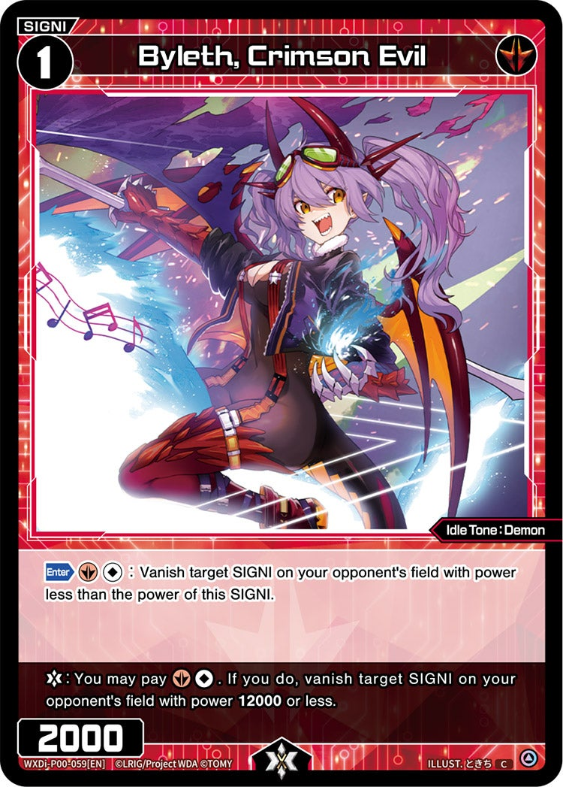

# Byleth, Crimson Evil

## Thông tin lá

| Trường | Giá trị |
| --- | --- |
| Mã in | WXDi-P00-059[EN] |
| Set | WXDi-P00[EN] |
| Số thứ tự | 059 |
| Loại thẻ | SIGNI |
| Vị trí | Main Deck |
| Số bản | — (set booster, không áp dụng) |
| Màu | Đỏ |
| Độ hiếm | C,C(P) |
| Minh họa | ときち |
| Level | 1 |
| Limit | — |
| Power | 2000 |
| LRIG type / Class | Idol Tone：Demon |
| Team / Master | — |
| Cost | — |
| Grow cost | — |
| Use timing | — |
| Life Burst | Có |

## Card text chính thức

[Enter] {Red} {Colorless}: Vanish target SIGNI on your opponent's field with power less than the power of this SIGNI.

## Power text / Life Burst

You may pay {Red} {Colorless}. If you do, vanish target SIGNI on your opponent's field with power 12000 or less.

## Ghi chú minh họa
Artist: ときち. Ảnh C được tải từ Card List tiếng Anh.

## FAQ chính thức

**Q. I put this SIGNI next to 《Hotarumaru, High Armed》 on the field. When I activate [Enter], is the power of this SIGNI referred to before or after it is added by the ability of 《Hotarumaru》？**
A. It refers to the value after it is added by 《Hotarumaru》's [Constant]. In this case, you can vanish a SIGNI with power 2000+3000, which is an opponent with power lower than 5000.

## Ảnh biến thể

- [C(P)](../images/WXDi-P00-059P-EN.jpg)

## Nguồn
[Card List/FAQ chính thức](https://www.takaratomy.co.jp/products/en.wixoss/card/card.html?card_no=WXDi-P00-059%5BEN%5D ) · [Ảnh thẻ](https://www.takaratomy.co.jp/products/en.wixoss/card/thumb/WXDi-P00-059%5BEN%5D.jpg)
