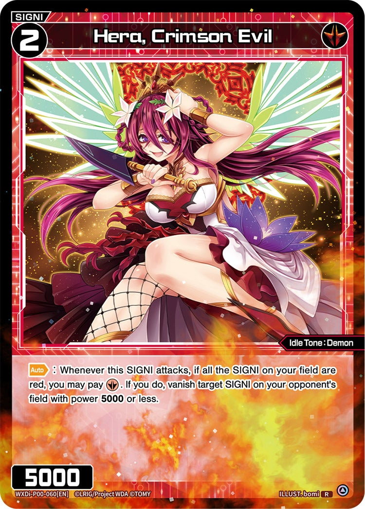

# Hera, Crimson Evil

## Thông tin lá

| Trường | Giá trị |
| --- | --- |
| Mã in | WXDi-P00-060[EN] |
| Set | WXDi-P00[EN] |
| Số thứ tự | 060 |
| Loại thẻ | SIGNI |
| Vị trí | Main Deck |
| Số bản | — (set booster, không áp dụng) |
| Màu | Đỏ |
| Độ hiếm | R,R(P) |
| Minh họa | bomi |
| Level | 2 |
| Limit | — |
| Power | 5000 |
| LRIG type / Class | Idol Tone：Demon |
| Team / Master | — |
| Cost | — |
| Grow cost | — |
| Use timing | — |
| Life Burst | Không |

## Card text chính thức

[Auto]: Whenever this SIGNI attacks, if all the SIGNI on your field are red, you may pay {Red}. If you do, vanish target SIGNI on your opponent's field with power 5000 or less.

## Power text / Life Burst

—

## Ghi chú minh họa
Artist: bomi. Ảnh R được tải từ Card List tiếng Anh.

## FAQ chính thức

**Q. If I don't have any other SIGNI in my SIGNI zone, does it satisfy the [Auto] requirement?**
A. Yes, even if there is only this one SIGNI, it still matches "all the SIGNI on your field are red".

**Q. Does [Auto] trigger when there is a red/blue SIGNI on the field, such as 《Bronze, Natural Crystal》?**
A. Yes, 《Bronze, Natural Crystal》 is also a red SIGNI, so it matches the "if all the SIGNI on your field are red,".

## Ảnh biến thể

- [R(P)](../images/WXDi-P00-060P-EN.jpg)

## Nguồn
[Card List/FAQ chính thức](https://www.takaratomy.co.jp/products/en.wixoss/card/card.html?card_no=WXDi-P00-060%5BEN%5D ) · [Ảnh thẻ](https://www.takaratomy.co.jp/products/en.wixoss/card/thumb/WXDi-P00-060%5BEN%5D.jpg)
