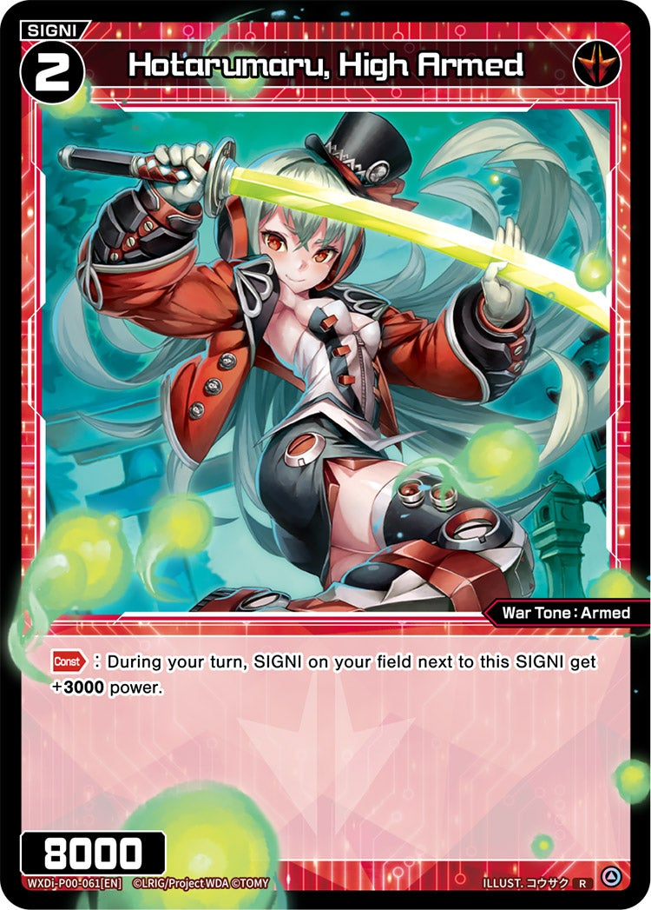

# Hotarumaru, High Armed

## Thông tin lá

| Trường | Giá trị |
| --- | --- |
| Mã in | WXDi-P00-061[EN] |
| Set | WXDi-P00[EN] |
| Số thứ tự | 061 |
| Loại thẻ | SIGNI |
| Vị trí | Main Deck |
| Số bản | — (set booster, không áp dụng) |
| Màu | Đỏ |
| Độ hiếm | R,R(P) |
| Minh họa | コウサク |
| Level | 2 |
| Limit | — |
| Power | 8000 |
| LRIG type / Class | War Tone：Armed |
| Team / Master | — |
| Cost | — |
| Grow cost | — |
| Use timing | — |
| Life Burst | Không |

## Card text chính thức

[Constant]: During your turn, SIGNI on your field next to this SIGNI get +3000 power.

## Power text / Life Burst

—

## Ghi chú minh họa
Artist: コウサク. Ảnh R được tải từ Card List tiếng Anh.

## FAQ chính thức

**Q. Where is "next to this SIGNI"?**
A. If this SIGNI is on the left or right, it points to the central SIGNI zone; if it is in the central SIGNI zone, it points to the left and right SIGNI zones.

**Q. If this SIGNI is in the right SIGNI zone, and the center SIGNI zone is erased by the effect of opponent's 《Umr =Tre=, Key to Salvation》, can the power of the SIGNI in the left SIGNI zone be added?**
A. No, you can't. If the center SIGNI zone is erased, the left and right SIGNI zones will not be treated as adjacent.

## Ảnh biến thể

- [R(P)](../images/WXDi-P00-061P-EN.jpg)

## Nguồn
[Card List/FAQ chính thức](https://www.takaratomy.co.jp/products/en.wixoss/card/card.html?card_no=WXDi-P00-061%5BEN%5D ) · [Ảnh thẻ](https://www.takaratomy.co.jp/products/en.wixoss/card/thumb/WXDi-P00-061%5BEN%5D.jpg)
