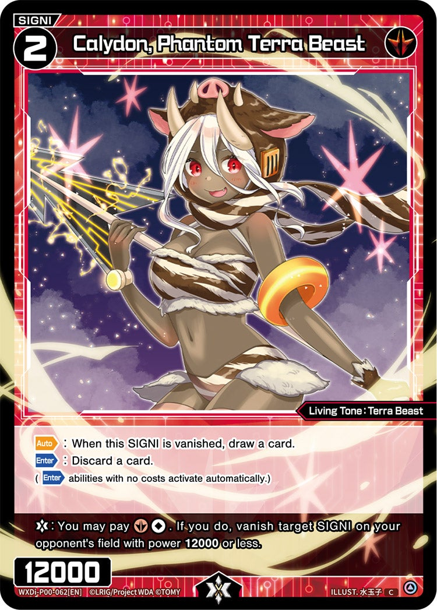

# Calydon, Phantom Terra Beast

## Thông tin lá

| Trường | Giá trị |
| --- | --- |
| Mã in | WXDi-P00-062[EN] |
| Set | WXDi-P00[EN] |
| Số thứ tự | 062 |
| Loại thẻ | SIGNI |
| Vị trí | Main Deck |
| Số bản | — (set booster, không áp dụng) |
| Màu | Đỏ |
| Độ hiếm | C,C(P) |
| Minh họa | 水玉子 |
| Level | 2 |
| Limit | — |
| Power | 12000 |
| LRIG type / Class | Living Tone：Terra Beast |
| Team / Master | — |
| Cost | — |
| Grow cost | — |
| Use timing | — |
| Life Burst | Có |

## Card text chính thức

[Auto]: When this SIGNI is vanished, draw a card.
[Enter]: Discard a card.
([Enter] abilities with no costs activate automatically.)

## Power text / Life Burst

You may pay {Red} {Colorless}. If you do, vanish target SIGNI on your opponent's field with power 12000 or less.

## Ghi chú minh họa
Artist: 水玉子. Ảnh C được tải từ Card List tiếng Anh.

## FAQ chính thức

**Q. Can I play this SIGNI when I don't have any cards in my hand?**
A. Yes, you can. [Enter] is forced, but if you have no cards in hand, you cannot discard, so nothing happens as a result, and this SIGNI stays in SIGNI zone.

## Ảnh biến thể

- [C(P)](../images/WXDi-P00-062P-EN.jpg)

## Nguồn
[Card List/FAQ chính thức](https://www.takaratomy.co.jp/products/en.wixoss/card/card.html?card_no=WXDi-P00-062%5BEN%5D ) · [Ảnh thẻ](https://www.takaratomy.co.jp/products/en.wixoss/card/thumb/WXDi-P00-062%5BEN%5D.jpg)
