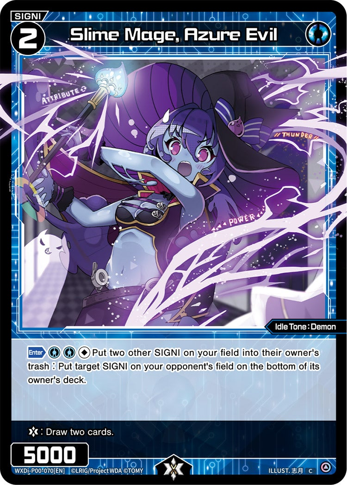

# Slime Mage, Azure Evil

## Thông tin lá

| Trường | Giá trị |
| --- | --- |
| Mã in | WXDi-P00-070[EN] |
| Set | WXDi-P00[EN] |
| Số thứ tự | 070 |
| Loại thẻ | SIGNI |
| Vị trí | Main Deck |
| Số bản | — (set booster, không áp dụng) |
| Màu | Xanh dương |
| Độ hiếm | C,C(P) |
| Minh họa | 志月 |
| Level | 2 |
| Limit | — |
| Power | 5000 |
| LRIG type / Class | Idol Tone：Demon |
| Team / Master | — |
| Cost | — |
| Grow cost | — |
| Use timing | — |
| Life Burst | Có |

## Card text chính thức

[Enter] {Blue} {Blue} {Colorless} Put two other SIGNI on your field into their owner's trash: Put target SIGNI on your opponent's field on the bottom of its owner's deck.

## Power text / Life Burst

Draw two cards.

## Ghi chú minh họa
Artist: 志月. Ảnh C được tải từ Card List tiếng Anh.

## FAQ chính thức

**Q. Does [Enter] cost put only my SIGNI from the field to Trash?**
A. Yes, only your own SIGNI, unless otherwise stated when you move cards for cost payment.

## Ảnh biến thể

- [C(P)](../images/WXDi-P00-070P-EN.jpg)

## Nguồn
[Card List/FAQ chính thức](https://www.takaratomy.co.jp/products/en.wixoss/card/card.html?card_no=WXDi-P00-070%5BEN%5D ) · [Ảnh thẻ](https://www.takaratomy.co.jp/products/en.wixoss/card/thumb/WXDi-P00-070%5BEN%5D.jpg)
