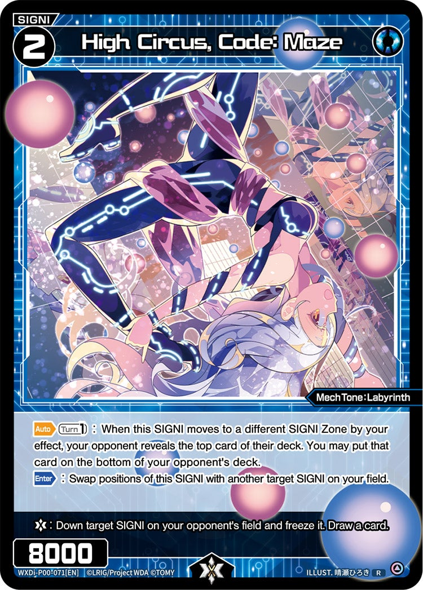

# High Circus, Code: Maze

## Thông tin lá

| Trường | Giá trị |
| --- | --- |
| Mã in | WXDi-P00-071[EN] |
| Set | WXDi-P00[EN] |
| Số thứ tự | 071 |
| Loại thẻ | SIGNI |
| Vị trí | Main Deck |
| Số bản | — (set booster, không áp dụng) |
| Màu | Xanh dương |
| Độ hiếm | R,R(P) |
| Minh họa | 晴瀬ひろき |
| Level | 2 |
| Limit | — |
| Power | 8000 |
| LRIG type / Class | Mech Tone：Labyrinth |
| Team / Master | — |
| Cost | — |
| Grow cost | — |
| Use timing | — |
| Life Burst | Có |

## Card text chính thức

[Auto] {1/Turn}: When this SIGNI moves to a different SIGNI Zone by your effect, your opponent reveals the top card of their deck. You may put that card on the bottom of your opponent's deck.
[Enter]: Swap positions of this SIGNI with another target SIGNI on your field.

## Power text / Life Burst

Down target SIGNI on your opponent's field and freeze it. Draw a card.

## Ghi chú minh họa
Artist: 晴瀬ひろき. Ảnh R được tải từ Card List tiếng Anh.

## FAQ chính thức

**Q. Does [Enter] of this SIGNI trigger its own [Auto]?**
A. Yes, it does.

## Ảnh biến thể

- [R(P)](../images/WXDi-P00-071P-EN.jpg)

## Nguồn
[Card List/FAQ chính thức](https://www.takaratomy.co.jp/products/en.wixoss/card/card.html?card_no=WXDi-P00-071%5BEN%5D ) · [Ảnh thẻ](https://www.takaratomy.co.jp/products/en.wixoss/card/thumb/WXDi-P00-071%5BEN%5D.jpg)
