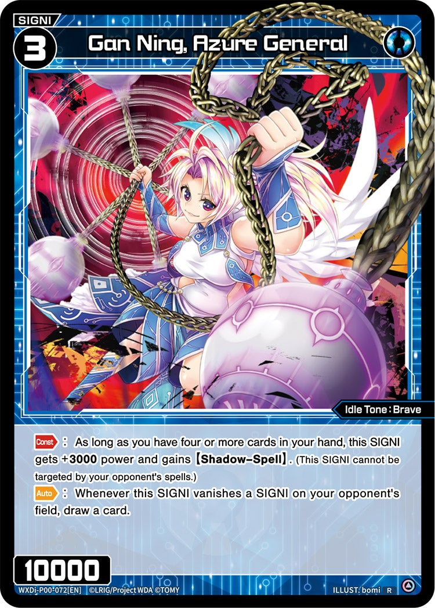

# Gan Ning, Azure General

## Thông tin lá

| Trường | Giá trị |
| --- | --- |
| Mã in | WXDi-P00-072[EN] |
| Set | WXDi-P00[EN] |
| Số thứ tự | 072 |
| Loại thẻ | SIGNI |
| Vị trí | Main Deck |
| Số bản | — (set booster, không áp dụng) |
| Màu | Xanh dương |
| Độ hiếm | R,R(P) |
| Minh họa | bomi |
| Level | 3 |
| Limit | — |
| Power | 10000 |
| LRIG type / Class | Idol Tone：Brave |
| Team / Master | — |
| Cost | — |
| Grow cost | — |
| Use timing | — |
| Life Burst | Không |

## Card text chính thức

[Constant]: As long as you have four or more cards in your hand, this SIGNI gets +3000 power and gains 【Shadow–Spell】. (This SIGNI cannot be targeted by your opponent's spells.)
[Auto]: Whenever this SIGNI vanishes a SIGNI on your opponent's field, draw a card.

## Power text / Life Burst

—

## Ghi chú minh họa
Artist: bomi. Ảnh R được tải từ Card List tiếng Anh.

## FAQ chính thức

**Q. If this SIGNI has 【Shadow–Spell】, will it be targeted by opponent's Spell card's Life Burst?**
A. No, [Shadow-Spell] will no longer be targeted by Life Burst of SPELL cards.

## Ảnh biến thể

- [R(P)](../images/WXDi-P00-072P-EN.jpg)

## Nguồn
[Card List/FAQ chính thức](https://www.takaratomy.co.jp/products/en.wixoss/card/card.html?card_no=WXDi-P00-072%5BEN%5D ) · [Ảnh thẻ](https://www.takaratomy.co.jp/products/en.wixoss/card/thumb/WXDi-P00-072%5BEN%5D.jpg)
