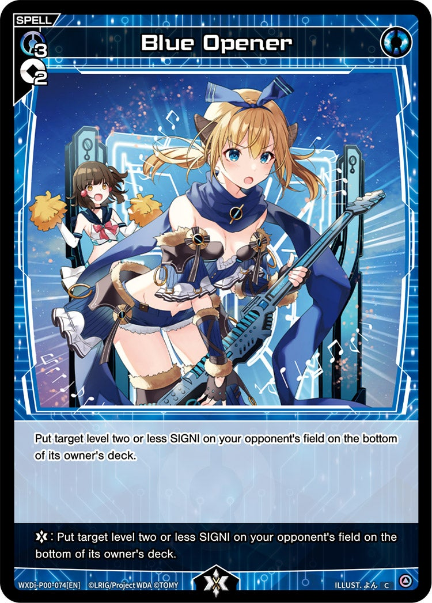

# Blue Opener

## Thông tin lá

| Trường | Giá trị |
| --- | --- |
| Mã in | WXDi-P00-074[EN] |
| Set | WXDi-P00[EN] |
| Số thứ tự | 074 |
| Loại thẻ | SPELL |
| Vị trí | Main Deck |
| Số bản | — (set booster, không áp dụng) |
| Màu | Xanh dương |
| Độ hiếm | C,C(P) |
| Minh họa | よん |
| Level | — |
| Limit | — |
| Power | 0 |
| LRIG type / Class | — |
| Team / Master | — |
| Cost | 《U》×３ / 《C》×２ |
| Grow cost | — |
| Use timing | — |
| Life Burst | Có |

## Card text chính thức

Put target level two or less SIGNI on your opponent's field on the bottom of its owner's deck.

## Power text / Life Burst

Put target level two or less SIGNI on your opponent's field on the bottom of its owner's deck.

## Ghi chú minh họa
Artist: よん. Ảnh C được tải từ Card List tiếng Anh.

## FAQ chính thức

— (không có FAQ riêng cho mã này trên trang FAQ tiếng Anh.)

## Ảnh biến thể

- [C(P)](../images/WXDi-P00-074P-EN.jpg)

## Nguồn
[Card List/FAQ chính thức](https://www.takaratomy.co.jp/products/en.wixoss/card/card.html?card_no=WXDi-P00-074%5BEN%5D ) · [Ảnh thẻ](https://www.takaratomy.co.jp/products/en.wixoss/card/thumb/WXDi-P00-074%5BEN%5D.jpg)
