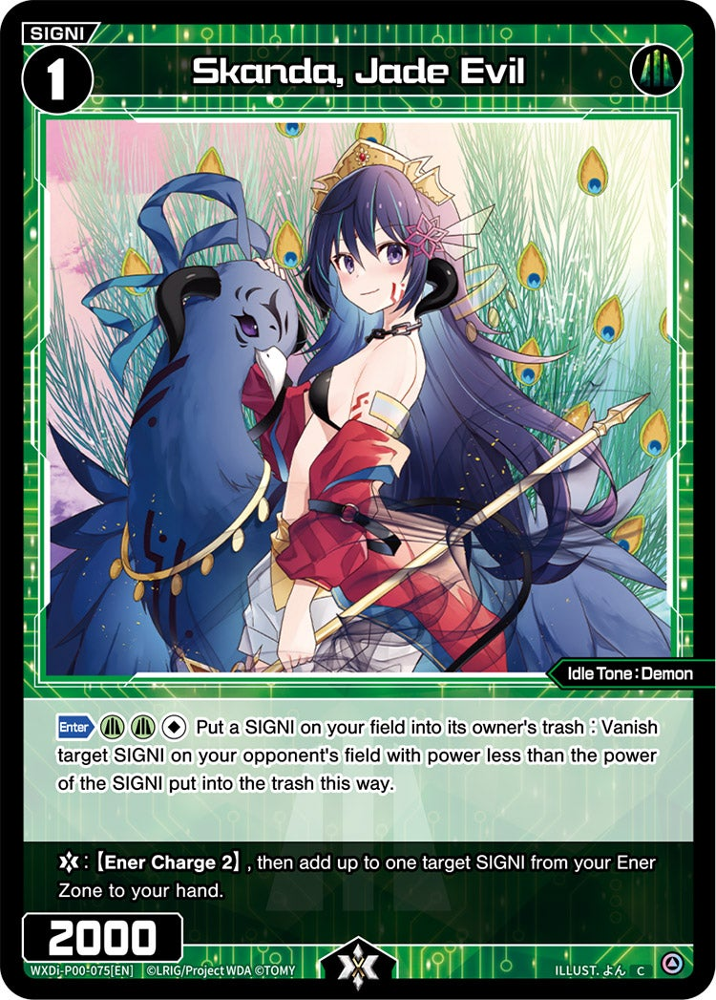

# Skanda, Jade Evil

## Thông tin lá

| Trường | Giá trị |
| --- | --- |
| Mã in | WXDi-P00-075[EN] |
| Set | WXDi-P00[EN] |
| Số thứ tự | 075 |
| Loại thẻ | SIGNI |
| Vị trí | Main Deck |
| Số bản | — (set booster, không áp dụng) |
| Màu | Xanh lá |
| Độ hiếm | C,C(P) |
| Minh họa | よん |
| Level | 1 |
| Limit | — |
| Power | 2000 |
| LRIG type / Class | Idol Tone：Demon |
| Team / Master | — |
| Cost | — |
| Grow cost | — |
| Use timing | — |
| Life Burst | Có |

## Card text chính thức

[Enter] {Green} {Green} {Colorless} Put a SIGNI on your field into its owner's trash: Vanish target SIGNI on your opponent's field with power less than the power of the SIGNI put into the trash this way.

## Power text / Life Burst

【Ener Charge 2】, then add up to one target SIGNI from your Ener Zone to your hand.

## Ghi chú minh họa
Artist: よん. Ảnh C được tải từ Card List tiếng Anh.

## FAQ chính thức

**Q. Does [Enter] cost put only my SIGNI from the field to Trash?**
A. Yes, only your own SIGNI, unless otherwise stated when you move cards for cost payment.

**Q. If SIGNI is put on Trash by [Enter] cost, and it has power had been added by effects, is the power referenced before or after it is put on Trash?**
A. Refers to the information of the SIGNI when it was in the field. If the SIGNI was in the field and its power was added by an effect, its value is referenced.

## Ảnh biến thể

- [C(P)](../images/WXDi-P00-075P-EN.jpg)

## Nguồn
[Card List/FAQ chính thức](https://www.takaratomy.co.jp/products/en.wixoss/card/card.html?card_no=WXDi-P00-075%5BEN%5D ) · [Ảnh thẻ](https://www.takaratomy.co.jp/products/en.wixoss/card/thumb/WXDi-P00-075%5BEN%5D.jpg)
