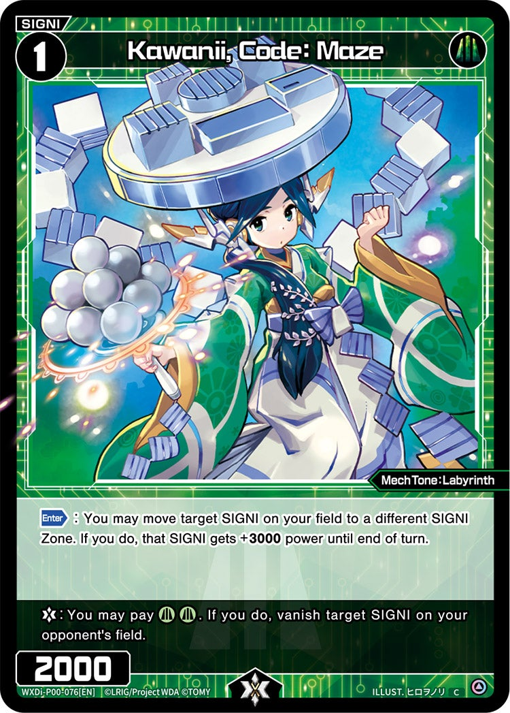

# Kawanii, Code: Maze

## Thông tin lá

| Trường | Giá trị |
| --- | --- |
| Mã in | WXDi-P00-076[EN] |
| Set | WXDi-P00[EN] |
| Số thứ tự | 076 |
| Loại thẻ | SIGNI |
| Vị trí | Main Deck |
| Số bản | — (set booster, không áp dụng) |
| Màu | Xanh lá |
| Độ hiếm | C,C(P) |
| Minh họa | ヒロヲノリ |
| Level | 1 |
| Limit | — |
| Power | 2000 |
| LRIG type / Class | Mech Tone：Labyrinth |
| Team / Master | — |
| Cost | — |
| Grow cost | — |
| Use timing | — |
| Life Burst | Có |

## Card text chính thức

[Enter]: You may move target SIGNI on your field to a different SIGNI Zone. If you do, that SIGNI gets +3000 power until end of turn.

## Power text / Life Burst

You may pay {Green} {Green}. If you do, vanish target SIGNI on your opponent's field.

## Ghi chú minh họa
Artist: ヒロヲノリ. Ảnh C được tải từ Card List tiếng Anh.

## FAQ chính thức

**Q. If there are already two SIGNI on the field and put this SIGNI on the field.**
A. This effect will not move SIGNI into a SIGNI zone that is already filled. As a result, nothing happens and no effect after "if you do" occurs.

## Ảnh biến thể

- [C(P)](../images/WXDi-P00-076P-EN.jpg)

## Nguồn
[Card List/FAQ chính thức](https://www.takaratomy.co.jp/products/en.wixoss/card/card.html?card_no=WXDi-P00-076%5BEN%5D ) · [Ảnh thẻ](https://www.takaratomy.co.jp/products/en.wixoss/card/thumb/WXDi-P00-076%5BEN%5D.jpg)
