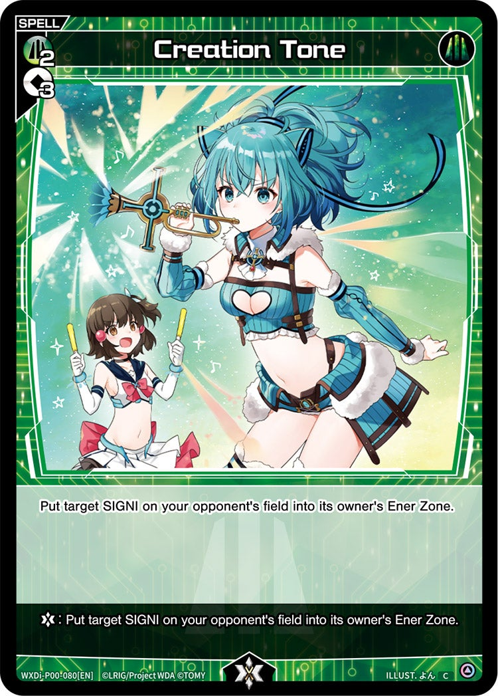

# Creation Tone

## Thông tin lá

| Trường | Giá trị |
| --- | --- |
| Mã in | WXDi-P00-080[EN] |
| Set | WXDi-P00[EN] |
| Số thứ tự | 080 |
| Loại thẻ | SPELL |
| Vị trí | Main Deck |
| Số bản | — (set booster, không áp dụng) |
| Màu | Xanh lá |
| Độ hiếm | C,C(P) |
| Minh họa | よん |
| Level | — |
| Limit | — |
| Power | 0 |
| LRIG type / Class | — |
| Team / Master | — |
| Cost | 《G》×２ / 《C》×３ |
| Grow cost | — |
| Use timing | — |
| Life Burst | Có |

## Card text chính thức

Put target SIGNI on your opponent's field into its owner's Ener Zone.

## Power text / Life Burst

Put target SIGNI on your opponent's field into its owner's Ener Zone.

## Ghi chú minh họa
Artist: よん. Ảnh C được tải từ Card List tiếng Anh.

## FAQ chính thức

**Q. If I target a SIGNI with "cannot be vanished", can I put it in the Ener zone?**
A. Yes, you can. This effect is not "vanish". So it can't be avoided by the "cannot be vanished" ability.

## Ảnh biến thể

- [C(P)](../images/WXDi-P00-080P-EN.jpg)

## Nguồn
[Card List/FAQ chính thức](https://www.takaratomy.co.jp/products/en.wixoss/card/card.html?card_no=WXDi-P00-080%5BEN%5D ) · [Ảnh thẻ](https://www.takaratomy.co.jp/products/en.wixoss/card/thumb/WXDi-P00-080%5BEN%5D.jpg)
