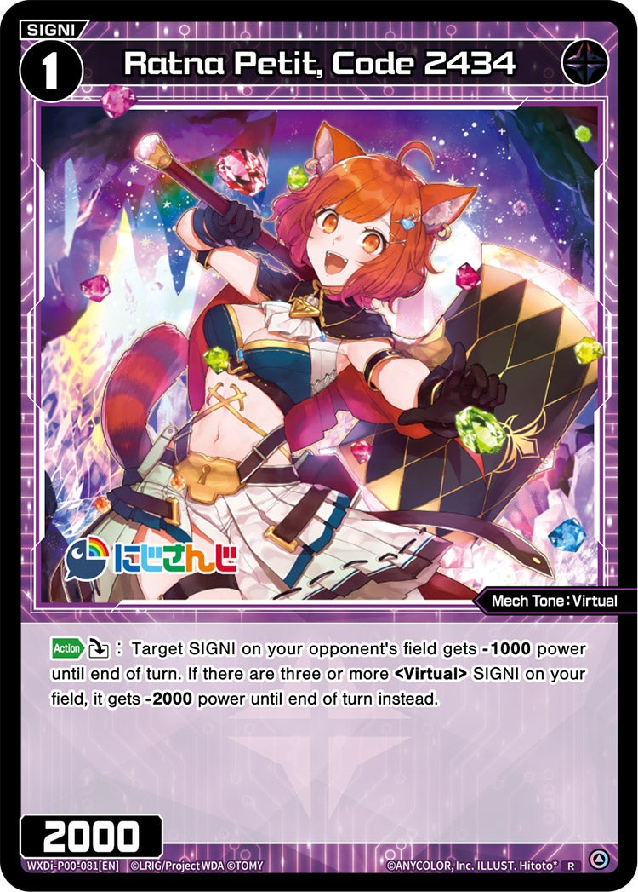

# Ratna Petit, Code 2434

## Thông tin lá

| Trường | Giá trị |
| --- | --- |
| Mã in | WXDi-P00-081[EN] |
| Set | WXDi-P00[EN] |
| Số thứ tự | 081 |
| Loại thẻ | SIGNI |
| Vị trí | Main Deck |
| Số bản | — (set booster, không áp dụng) |
| Màu | Đen |
| Độ hiếm | R,R(P) |
| Minh họa | Hitoto* |
| Level | 1 |
| Limit | — |
| Power | 2000 |
| LRIG type / Class | Mech Tone：Virtual |
| Team / Master | — |
| Cost | — |
| Grow cost | — |
| Use timing | — |
| Life Burst | Không |

## Card text chính thức

[Action] {Down}: Target SIGNI on your opponent's field gets -1000 power until end of turn. If there are three or more <Virtual> SIGNI on your field, it gets -2000 power until end of turn instead.

## Power text / Life Burst

—

## Ghi chú minh họa
Artist: Hitoto*. Ảnh R được tải từ Card List tiếng Anh.

## FAQ chính thức

**Q. After I used Action ability to reduce the power of my opponent's SIGNI -1000, I now have 3 <Virtual> SIGNI in my field. Does the value that was previously minus by Action ability increase to -2000?**
A. No, it remains at -1000.
The number of <Virtual> SIGNI is checked only when you use the Action ability, and if there are not, the value is -1000, if there are, the value is -2000.
After that, even if the number of <Virtual> SIGNI changes during that turn, the negative value of this ability once used will not increase or decrease.

## Ảnh biến thể

- [R(P)](../images/WXDi-P00-081P-EN.jpg)

## Nguồn
[Card List/FAQ chính thức](https://www.takaratomy.co.jp/products/en.wixoss/card/card.html?card_no=WXDi-P00-081%5BEN%5D ) · [Ảnh thẻ](https://www.takaratomy.co.jp/products/en.wixoss/card/thumb/WXDi-P00-081%5BEN%5D.jpg)
