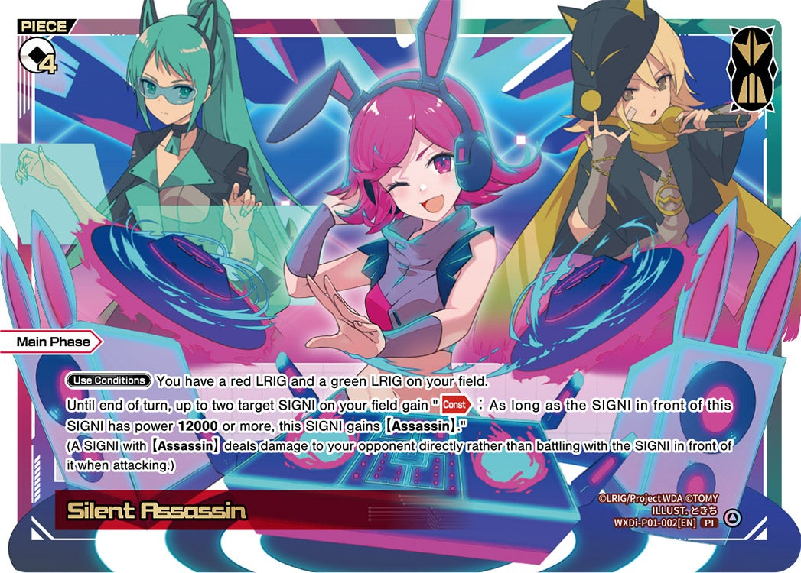

# Silent Assassin

## Thông tin lá

| Trường | Giá trị |
| --- | --- |
| Mã in | WXDi-P01-002[EN] |
| Set | WXDi-P01[EN] |
| Số thứ tự | 002 |
| Loại thẻ | PIECE |
| Vị trí | LRIG Deck |
| Số bản | — (set booster, không áp dụng) |
| Màu | Đỏ / xanh lá |
| Độ hiếm | PI |
| Minh họa | ときち |
| Level | — |
| Limit | — |
| Power | 0 |
| LRIG type / Class | — |
| Team / Master | — |
| Cost | 《C》×４ |
| Grow cost | — |
| Use timing | Main Phase |
| Life Burst | Không |

## Card text chính thức

[Use Conditions] You have a red LRIG and a green LRIG on your field.

Until end of turn, up to two target SIGNI on your field gain "[Constant]: As long as the SIGNI in front of this SIGNI has power 12000 or more, this SIGNI gains 【Assassin】."
(A SIGNI with 【Assassin】 deals damage to your opponent directly rather than battling with the SIGNI in front of it when attacking.)

## Power text / Life Burst

—

## Ghi chú minh họa
Artist: ときち. Ảnh PI được tải từ Card List tiếng Anh.

## FAQ chính thức

— (không có FAQ riêng cho mã này trên trang FAQ tiếng Anh.)

## Nguồn
[Card List/FAQ chính thức](https://www.takaratomy.co.jp/products/en.wixoss/card/card.html?card_no=WXDi-P01-002%5BEN%5D ) · [Ảnh thẻ](https://www.takaratomy.co.jp/products/en.wixoss/card/thumb/WXDi-P01-002%5BEN%5D.jpg)
